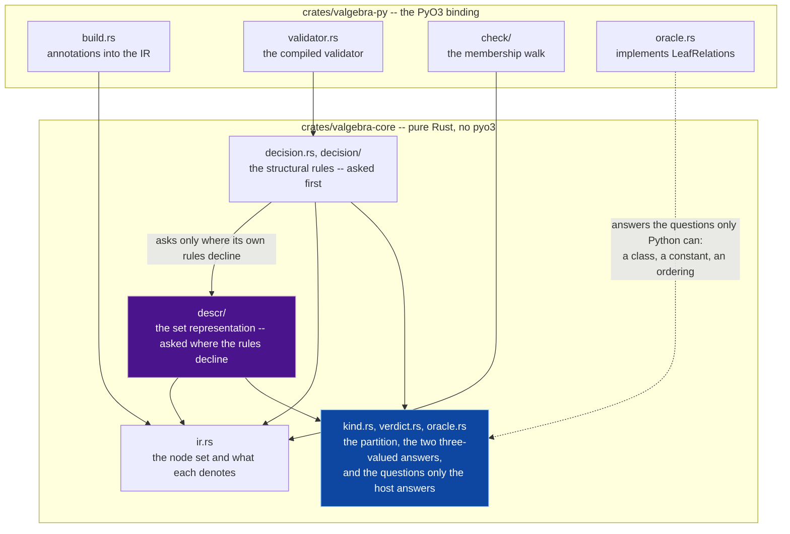
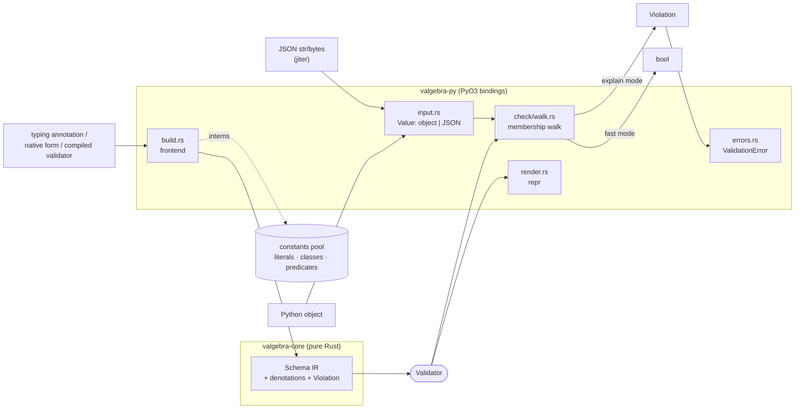

# Architecture

Two Rust crates and a Python package. This page owns the split between them, the
direction their dependencies run, how a value and a pair of schemas pass through
them, the invariants every zone keeps, every bound, and the designs refused for
the shape of the whole. `ARCHITECTURE.md` at the root is a map onto this page and
the ones beside it, and carries no claim of its own.

## The zones

| Zone | Owns | Page |
|---|---|---|
| `crates/valgebra-core/src/ir.rs`, `ir/` | the schema IR: the node set, what each node denotes, the sharing of nodes built alike (`ir/intern.rs`), and the rewrites from one node to another (`ir/transform.rs`) | [01-schema-ir.md](01-schema-ir.md) |
| `crates/valgebra-core/src/lib.rs` | the core crate's root: the modules it declares, the names the binding imports from it, and the `forbid(unsafe_code)` below | this page |
| `crates/valgebra-core/src/kind.rs`, `verdict.rs`, `oracle.rs` | the value-universe partition, its region summary, the two three-valued answers, and `LeafRelations`, the questions only the host can answer and the default that answers none — the frame both deciders and the constructors read | [02-decision.md](02-decision.md) |
| `crates/valgebra-core/src/carries.rs` | whether the values a base admits can answer a constraint: the one rule the frontend refuses a refinement by and the laws' generator draws its refinements by | [03-frontend.md](03-frontend.md) |
| `crates/valgebra-core/src/decision.rs`, `decision/` | the structural rules: subtyping, equivalence and disjointness in the file, emptiness and the constructor rules one module each beside it | [02-decision.md](02-decision.md) |
| `crates/valgebra-core/src/descr/` | the set representation: one component per kind, each closed under the three operations. `lower.rs` maps a term to a set and holds the build's `Bounds`; the components are `integers.rs` and its span arithmetic (`interval.rs`), `floats.rs`, `regular.rs` for the two word kinds, `records.rs`, `maps.rs`, `sets.rs` and `symbolic.rs` for the sequence automaton, `classes.rs` for the class atoms; `lines.rs` is the per-kind normal form they share, `automaton.rs` the state bound and the walks the two automata share, `polar.rs` the union of summands under a polarity that a lattice built from parts holds its set as, `values.rs` the `T⊥` a key or attribute holds, and `budget.rs` what a build may spend | [02-decision.md](02-decision.md) |
| `crates/valgebra-py/src/build.rs`, `build/` | typing annotations and native forms into the IR: the dispatch, the pool and the guard in the file, the marker protocol in `build/refine.rs`, what a class declares in `build/classes.rs`, the typing introspection in `build/generics.rs`, and the regex forms the two engines read as two languages, refused in `build/dialect.rs` | [03-frontend.md](03-frontend.md) |
| `crates/valgebra-py/src/check.rs`, `check/` | the membership walk: the aggregator that re-exports it in `check.rs`, the dispatcher in `walk.rs`, the leaves in `walk/scalar.rs`, the containers in `walk/record.rs` and `walk/sequence.rs`, and the per-validator precompute in `check/index.rs`. `check/ctx.rs` holds the read-only context a walk threads, its two depth bounds and the trail that refuses a cyclic value; `check/violation.rs` builds the structured failure a walk records, whose type is `crates/valgebra-core/src/violation.rs` | [04-walk.md](04-walk.md) |
| `crates/valgebra-py/src/input.rs` | the `Value` the walk runs over: a borrowed Python object or a borrowed parsed JSON value, and the decoders that turn a caller's `str` or `bytes` into one — which is what keeps the two input paths membership-equivalent by construction | [04-walk.md](04-walk.md) |
| `crates/valgebra-py/src/equality.rs` | `==` on two validators, read through the constant pools rather than slot for slot: whether two schemas *are* the same set, which is what the constructors settle and not what the decision procedures prove | [01-schema-ir.md](01-schema-ir.md) |
| `crates/valgebra-core/src/violation.rs`, `codes.rs` | the structured failure a walk records, and the codes a node reports that the binding's walk reports too, spelled once | [05-errors.md](05-errors.md) |
| `crates/valgebra-py/src/errors.rs`, `exception.rs`, `codes.rs`, `render.rs` | the Python exception, named in the leaf `exception.rs` and raised from a `Violation` by `errors.rs`; the failure codes the walk writes, named once in `codes.rs`; and the annotation render | [05-errors.md](05-errors.md) |
| `crates/valgebra-py/src/oracle.rs` | the binding's half of `LeafRelations`: the questions the core cannot decide alone — whether a literal belongs to a set, whether two sets of constants share a value, how two bounds order, what an enumeration lists | [02-decision.md](02-decision.md) |
| `python/valgebra/` | the Python half of the package: `__init__.py` re-exports the extension's names and is what `import valgebra` costs, `_markers.py` defines `Regex`, the one refinement marker neither typing nor `annotated_types` provides, and `_valgebra.pyi` is the stub `stubtest` holds against the built extension | [03-frontend.md](03-frontend.md) |
| `crates/valgebra-py/src/validator.rs` | the compiled `Validator`: the object a caller holds and every method on it, the three construction limits, and `checked`, which refuses a schema past them and prunes the definitions nothing reaches | [03-frontend.md](03-frontend.md) |
| `crates/valgebra-py/src/lib.rs` | the module: what the extension exports, the three set combinators (`union`, `intersection`, `complement`), the `recursive` fixpoint, `instance_of` for a class alone, and the two lattice bounds `anything` and `nothing` | [03-frontend.md](03-frontend.md) |
| `crates/valgebra-py/src/workload.rs` | the instruction gate's instrument: the shapes `scripts/perf_gate.py --binding-*` measures, which no caller reaches and no suite runs, so coverage and the mutation sweep skip it by name | [07-tooling-ci.md](07-tooling-ci.md) |

`scripts/docs_lint.py` holds the table to the tree: a production source file
under `crates/*/src` that no row names fails, as does a row naming a path the
tree does not hold, and a row naming a directory owns every file below it.
A file's page is the one a change to it fixes in the same commit.

`crates/valgebra-core` is pure Rust. `crates/valgebra-py` is the PyO3 binding.
`python/valgebra/` re-exports the compiled extension and adds one marker class,
`Regex`, beside it.

## The direction

`valgebra-py` depends on `valgebra-core`. `valgebra-py` builds as a `cdylib`, the
extension the wheel ships, and as an `rlib` for its own
`crates/valgebra-py/examples/binding_workload.rs`
(`crates/valgebra-py/Cargo.toml`); no other crate depends on it.

Three edges in that picture are the ones a change has to respect. **The frame
sits below both deciders**, not inside either. **The edge from the rules to the
descriptor runs one way**, and there is no edge back. And the dotted edge is
not a dependency at all -- it is a trait the core defines and the binding
implements, which is how a pure-Rust crate asks a question only Python can
answer.

**Inside the core, the set representation imports nothing from the structural
rules.** The two are sound deciders with partly disjoint reach: the descriptor
builds the set a schema denotes from the term alone and decides every relation
between two sets it builds, and the rules decide by shape, reaching the
recursive schemas, predicates and hooked classes the descriptor cannot build.
The descriptor is what the rules hand a pair they decline, and built from a
rule it would carry that rule's defect into the answer given where the rule
declined. So the frame both read — the `Kind` partition, its `Region` summary,
the `Verdict`/`Relation` answers and the `LeafRelations` questions — sits in
`kind.rs`, `verdict.rs` and `oracle.rs` below the pair rather than inside
either. The reverse edge is allowed and used: `decision.rs` asks
`descr::lower` where its own rules decline. `tests/test_module_direction.py`
holds both halves, and [02-decision.md](02-decision.md) says what each decider
reaches.

Modules import each other in five places, each named with what crosses it in
`ADMITTED_CYCLES` of `tests/test_refusals_ledger.py`, which fails on a cycle it
does not name and on a named one the tree does not hold. Within the binding,
`crates/valgebra-py/src/validator.rs` and `crates/valgebra-py/src/build.rs`
depend on each other, and that pair is a dependency rather than a placement:
the frontend needs the validator because an already compiled validator is
itself a schema description, and the validator needs the frontend to compile
one. The validator also renders its schema through
`crates/valgebra-py/src/render.rs`, which asks the frontend's `declares_fields`
whether a class declares fields, so the three are one cycle.
`crates/valgebra-py/src/check/walk.rs` calls the violation builders in
`check/violation.rs`, which call back into the walk's `record_if_fatal`. Two
pairs sit inside one zone and cross only functions: the record and scalar
walks in `check/walk/`, and what a class declares and the typing introspection
in `build/`. In the core, `ir.rs` folds the complement law through `oracle.rs`,
which reads the `Schema` it is asked about and the `Constants` a lowering is
given, so the term, the oracle and the descriptor's lowering are one cycle,
with the components a lowering builds and the budget they spend, which reads
the allowance `descr/lower.rs` defines. A type the binding's modules share
lives outside the aggregator that re-exports it --
`crates/valgebra-py/src/exception.rs`, `crates/valgebra-py/src/check/ctx.rs` --
so no member imports its parent back and no call site spells a longer path.

No cycle costs anything the build can see. rustc's compilation unit is the crate,
and the shipped artifact is one `.so` statically linking `valgebra-core`, so at
the granularity the build has this is one node.

## Two invariants the compiler holds

**`#![forbid(unsafe_code)]` in both crates.** Zero `unsafe` blocks, and a future
one fails the build. The security policy's no-unsafe guarantee is a fact of the
compiler rather than a sentence in a document.

**`valgebra-core` has no `pyo3` dependency.** The core owns the IR, its
denotation and the decision procedure, and cannot see a Python object. That is
what lets the decision procedure be tested against a Rust value model with no
interpreter in the loop, and it is checkable in one line of
`crates/valgebra-core/Cargo.toml`.

The second invariant is why the core asks the binding about anything it cannot
decide alone, through the `LeafRelations` trait: a class hierarchy and a concrete
value are Python facts, and the core takes them as answers rather than reaching
for them. [02-decision.md](02-decision.md) owns that boundary.

## How a value flows

**Compile once.** The frontend (`crates/valgebra-py/src/build.rs`) reads a
typing annotation, a native form (a dict literal as a closed record, a constant
as a typed literal), or an already compiled validator, and builds the `Schema`
IR, interning any literal, class or predicate it references into the constants
pool. `checked` in `crates/valgebra-py/src/validator.rs` refuses a schema past
the construction limits and prunes the definitions nothing reaches, and the
result is wrapped in a `Validator`, which never changes after it is built.

**Validate fast.** Each call crosses into Rust once. The value -- a Python object
or a JSON document -- is presented through one `Value`
(`crates/valgebra-py/src/input.rs`), and one membership walk
(`crates/valgebra-py/src/check/walk.rs`) decides it, in one of three modes: a
*fast* mode that returns a bool and allocates nothing but what a measured
reading pays for ([04-walk.md](04-walk.md)), an *explain* mode that builds a
`Violation` with the path, the expected label and a value summary for each
independent failure, and a *fail-fast* explain mode that builds the first. A
`Violation` becomes the `ValidationError` (`crates/valgebra-py/src/errors.rs`)
that `validate` raises.

`is_valid_json` walks the parsed document in place, and `validate_json` and
`load` walk the Python value the parser builds, so a document gets the decision
and the errors `json.loads` of it would, except where the JSON grammar is
stricter (`docs/07-json.md`).

The constants pool is one `Vec<Py<PyAny>>` holding four kinds of object — a
literal's constant, a class, a comparison operand, a user predicate — addressed
by four distinct index types. [06-type-design.md](06-type-design.md) owns why.

## How two schemas are compared

`is_subtype_of`, `relation_to`, `is_equivalent` and `is_empty` take no value, so
they run entirely in the core. Two sound deciders answer them, each in three
values -- proved, refuted, or neither: the structural rules in `decision.rs`
recurse over the two trees, and the set representation in `descr/` builds the
set each schema denotes and asks whether `a ∧ ¬b` admits a value. The rules are
asked first and the descriptor only where they decline, because building a set
costs about three orders of magnitude more than a rule that already answered
(`scripts/perf_gate.py --decision-sets` against `--decision-rules`, one corpus
asked of both); the rules alone reach a recursive schema, a predicate or a
hooked class. A question about a class, a constant or a comparison operand is
asked back through `LeafRelations`, which `crates/valgebra-py/src/oracle.rs`
implements. [02-decision.md](02-decision.md) owns the detail and
`docs/15-decidability.md` the published boundary.

## The invariants every zone keeps

A change that breaks one of these is a defect, not a trade-off.

- **One walk.** Deciding and explaining are one `member` function parameterized
  by the walk's mode. Where a reading has a reader per mode, a test rather than
  the construction holds the pair to one verdict ([04-walk.md](04-walk.md)).
- **One boundary crossing.** Tree walks, key lookups and bound checks run in the
  Rust validator tree, and no per-element Python work is added to the loop. A
  user predicate is a documented Python-callback slow path, never a silent
  fallback.
- **Check, don't parse.** `validate` and `is_valid` check membership of the
  object the caller holds and never copy or coerce it. `ensure` is the
  separate, value-returning mode, and `load` the one for JSON.
- **Immutable validators.** A compiled validator never changes after it is
  built, so one is shared across threads. The extension declares
  `gil_used = false` (`crates/valgebra-py/src/lib.rs`), so a free-threaded
  CPython imports it without re-enabling the GIL, and `tests/test_concurrency.py`
  validates in parallel there.

## One zone a file

**A production file is one zone of the table above, or the readers of one node
family inside a zone, and a test file is the test module of the file that
declares it.** `check/walk/sequence.rs` is the sequences, `descr/records.rs` the
record atoms, `decision/tests.rs` the tests `decision.rs` declares. A file
holding neither is split along what it holds. A file holding one is not split
for its length: the zone table, the mutation sweeps and the per-file coverage
floors each take a file as their unit, so one family across two files is half a
family to all three.

## What the core does not contain

No Python. No coercion: validation is a membership test on the object the caller
already holds, and no value is copied or converted on the accept path. No I/O:
the JSON parse is the binding's, in `crates/valgebra-py/src/input.rs` over
`jiter`, and `crates/valgebra-core/Cargo.toml` carries no parser.

## Every bound, and what holds it

Nothing here is unbounded. A schema is built under limits, a walk descends under
one, a decision spends a budget, and every representation in the descriptor
refuses past a size rather than returning a set it cannot hold. They live across
both crates, so without one list a reader cannot tell a measured bound from a
guessed one, and adding another costs nothing.

The rule is: **no bound without a gate that measures it.** Adding one means
adding a row here and a test that reaches it. The table is held to the tree in
both directions by `scripts/docs_lint.py`, values included, so a number that
moves in the source and not here fails, and a row naming a constant that is gone
fails too.

Each row says which of five kinds its bound is, because they are not the same
sort of thing and only one of them is a defect.

* **limit** -- past it this representation holds no sound answer, so the
  operation refuses rather than approximating. A set too wide is complemented
  into one too narrow, which is why rounding is never the alternative. These are
  the bounds the algebra asks for.
* **shape** -- a bound on a value or a schema a caller wrote: how deep it nests,
  how many members it has, how much of it an error message prints. A caller can
  see these and work within them.
* **debt** -- a budget on *work*, standing in for a termination argument that is
  not written. Each names the work that removes it, and none of them is called a
  limit in the meantime.
* **cost** -- a budget on *work* the procedure finishes without: it terminates
  by an argument written beside the bound, and the bound caps how long a caller
  waits on an input whose finite work is exponential. Raising one decides more
  relations and costs more, as a reach does, but it caps what a reading spends
  rather than what it is given.

* **reach** -- how much of a schema a reading is *given to build from*, rather
  than what it may spend building. Raising one decides more relations and costs
  more; nothing is unsound at any setting, which is what separates it from a
  limit, and no caller writes it, which is what separates it from a shape.

A bound that is `debt` carries the change that retires it in its own doc
comment, and a `cost` carries where its termination argument is written. A
`limit`, a `shape` or a `reach` carries the reason it is where it is.

**A bound that protects the stack is a reading of the shipped wheel on a 1 MiB
thread.** The profile-guided build inlines a walk's arms into frames several
times a plain release build's, so a depth bound is set from the profile-guided
wheel's frames against 1 MiB, the least stack any thread CPython creates has,
and `tests/test_adversarial_bounds.py` runs the deepest walks and relations on a
thread of that size, which the release smoke runs on every wheel it loads. A
plain or unoptimized build fits another figure and is a build nothing ships; a
thread a host starts smaller can overflow before the bound refuses, which
`docs/10-limits.md` tells a caller.

A row kinded **not a bound** is possible. The scan that holds this table to the
tree reads every file-scope integer constant in a crate's source whose value is a
figure somebody chose, and some of those are capacities rather than bounds -- how
much a buffer reserves up front, how wide a table may be and sit on the stack. The
table carries each with a row saying so, which is cheaper than an exclusion list
nobody maintains and honest about what the rule can see; the kind column is where
a reader sees it without reading to the end of the row. A width read off a
table's length is outside the scan: it is the table's size, in one place.

| where | bound | value | kind | what it stops | what measures it |
|---|---|---|---|---|---|
| `crates/valgebra-py/src/validator.rs` | `MAX_SCHEMA_DEPTH` | `128` | shape | nesting in a constructed schema | `tests/test_adversarial_bounds.py` |
| `crates/valgebra-py/src/validator.rs` | `MAX_DEFINITIONS` | `128` | shape | recursive definitions chained in one schema | `tests/test_adversarial_bounds.py` |
| `crates/valgebra-py/src/validator.rs` | `MAX_SCHEMA_NODES` | `100_000` | shape | a schema that is shallow and exponentially wide, combined in a loop or read from an annotation whose shared parts multiply, which the frontend refuses as it reads | `tests/test_adversarial_bounds.py`, `crates/valgebra-py/src/build/tests.rs` |
| `crates/valgebra-py/src/build.rs` | `MAX_BUILD_DEPTH` | `crate::validator::MAX_SCHEMA_DEPTH + 1` | shape | the frontend descending past what `checked` will accept, so the schema past the bound is built and refused by name | `tests/test_adversarial_bounds.py` |
| `crates/valgebra-py/src/build/classes.rs` | `MAX_ANNOTATION_DEPTH` | `64` | shape | the walk that decides whether a class's annotations can be read as written overflowing the stack on a nested alias; past it the reading declines and `get_type_hints` answers | `annotations_as_written_are_the_hints_get_type_hints_returns` in `crates/valgebra-py/src/build/tests.rs` |
| `crates/valgebra-py/src/build/generics.rs` | `MAX_QUALIFIER_DEPTH` | `8` | shape | a dict-literal field whose `Annotated` or `ReadOnly` wrapper names itself as what it wraps, so reading through it for a `NotRequired` never ends; past it the field is built, and the build's depth guard refuses it | `test_a_field_wrapping_itself_is_refused_by_depth` in `tests/test_records.py` |
| `crates/valgebra-py/src/build/refine.rs` | `MAX_MARKER_TYPES` | `256` | shape | the per-type cache of which attributes a refinement marker carries growing with a program that builds a marker class per call, since a cache entry keeps its type alive | `tests/test_adversarial_bounds.py` |
| `crates/valgebra-py/src/build/refine.rs` | `MAX_GROUPING_DEPTH` | `8` | shape | a marker that stands for the constraints it yields answering with itself, so following it runs off the stack | `tests/test_frontend_forms.py` |
| `crates/valgebra-py/src/render.rs` | `MAX_RENDER_DEPTH` | `200` | shape | `repr` overflowing the stack on a chain of definitions | `tests/test_adversarial_bounds.py`, and `tests/test_repr.py` at the step across it |
| `crates/valgebra-py/src/check/walk.rs` | `MAX_LABEL_UNFOLDS` | `4` | shape | a union's branch label following a chain of references, where a definition naming another names one forever | `tests/test_union_messages.py` |
| `crates/valgebra-py/src/check/ctx.rs` | `MAX_WALK_DEPTH` | `3 * MAX_RECURSION_DEPTH` | shape | a walk overflowing a 1 MiB thread stack on the profile-guided wheel; three levels an unfolding, so the smallest recursive body is walked to the unfolding bound | its own tests, and `tests/test_adversarial_bounds.py` on a 1 MiB thread, which the release smoke runs on every wheel it loads |
| `crates/valgebra-py/src/check/ctx.rs` | `MAX_RECURSION_DEPTH` | `128` | shape | a pathologically deep *value* overflowing the stack | its own tests, and `tests/test_adversarial_bounds.py` |
| `crates/valgebra-py/src/check/ctx.rs` | `FIRST_TRAIL` | `16` | not a bound | nothing: the pairs the recursion trail reserves on its first level, so a value nested that deep asks the allocator once rather than once per doubling | `the_first_level_reserves_the_levels_after_it` in `crates/valgebra-py/src/check/ctx/descent_tests.rs`, and `--binding-recursive` |
| `crates/valgebra-py/src/check/memo.rs` | `PLANNED_DEFINITIONS` | `u128::BITS as usize` | not a bound | nothing: the definitions the memo's plan names, one bit each; the validator's `MAX_DEFINITIONS` sits inside it, which a compile-time assertion beside it holds | the assertion, and `crates/valgebra-py/src/check/walk/memo_tests.rs` |
| `crates/valgebra-py/src/check/walk/record.rs` | `FOUND_ON_STACK` | `16` | not a bound | nothing: how wide a record's per-object field table may be and sit on the stack when a parsed JSON object is read; a wider record takes a heap table and decides alike | `test_a_record_reads_a_document_at_every_width` in `tests/test_json.py`, and `--binding-json` |
| `crates/valgebra-py/src/oracle.rs` | `MAX_ENUM_MEMBERS` | `512` | shape | one relation turning into a membership question per member of an enumeration | its own tests, and `tests/test_algebra_closure.py` |
| `crates/valgebra-py/src/check/walk/sequence.rs` | `SNAPSHOT_MIN_ELEMENTS` | `16` | shape | a list too narrow for a snapshot of it to pay for its own allocation | `tests/test_walk_edges.py`, and `scripts/perf_gate.py --binding` |
| `crates/valgebra-py/src/check/walk/sequence.rs` | `SNAPSHOT_MAX_ELEMENTS` | `262_144` | shape | a snapshot large enough that walking the copy costs more cache than the reference counts it avoids, and two mebibytes of transient with it | `tests/test_walk_edges.py`, and `scripts/perf_gate.py --binding` |
| `crates/valgebra-py/src/check/walk/record.rs` | `SMALL_OBJECT` | `8` | shape | an object narrow enough that a table of its keys costs more than looking forward for a repeat of each, and a record whose clause reads keys declaring so few fields that searching a parsed object for each costs less than resolving its keys through the plan | the walk's corpus in `crates/valgebra-py/src/check/walk/interpreter.rs`, and `scripts/compare_gate.py` |
| `crates/valgebra-py/src/check/walk.rs` | `CLOSEST_BRANCH_PROBE_LIMIT` | `64` | shape | the error path's second walk costing the branch count | `tests/test_union_messages.py` |
| `crates/valgebra-py/src/check/walk.rs` | `UNION_LABEL_LIMIT` | `64` | shape | a union naming a thousand labels in one `expected` | its own tests |
| `crates/valgebra-core/src/descr/lower.rs` | `UNFOLDS` | `1` | reach | a fixpoint unfolded past its own body, which multiplies the schema the descriptor must build against its node bound for relations nobody asks about | `crates/valgebra-core/src/laws.rs`, and `tests/test_completeness_ledger.py` |
| `crates/valgebra-core/src/decision.rs` | `MAX_DECISION_DEPTH` | `512` | shape | a relation overflowing the stack where the coinductive hypothesis is met only far down -- two cycles of coprime length, a long chain of definitions -- or where a product is split across a wide union a branch a level, which the step budget never counts: a level is about 1 KiB on the profile-guided wheel, so the bound fits half of a 1 MiB thread | `the_depth_bound_declines_and_gives_its_levels_back` and `the_product_rule_takes_a_level_for_each_branch_it_narrows_by` in `crates/valgebra-core/src/decision/budget_tests.rs`, and `tests/test_adversarial_bounds.py` on a 1 MiB thread |
| `crates/valgebra-core/src/decision.rs` | `DECISION_BUDGET` | `1_000_000` | cost | one query spending more work than a caller waits for: every goal is drawn from a finite closure of the query's subterms, so the decision terminates without this figure, and the figure caps the search that closure allows, which is exponential | its own tests, `crates/valgebra-core/src/decision/goal_tests.rs`, and `tests/test_decision_adversarial.py` |
| `crates/valgebra-core/src/descr/lower.rs` | `BUDGET` | `64` | debt | the schema nodes one lowering reads | its own tests, and `crates/valgebra-core/benches/core.rs` |
| `crates/valgebra-core/src/descr/lower.rs` | `DEPTH` | `5` | debt | the nesting one lowering descends, which is the exponential | its own tests, and `crates/valgebra-core/benches/core.rs` |
| `crates/valgebra-core/src/descr/lower.rs` | `WORK` | `4096` | debt | the multiplying work one build spends before refusing | its own tests, and `crates/valgebra-core/benches/core.rs` |
| `crates/valgebra-core/src/descr/lines.rs` | `MAX_LINES` | `256` | limit | the lines one kind carries, which a meet multiplies and a complement doubles | `crates/valgebra-core/src/descr/mod.rs` tests |
| `crates/valgebra-core/src/descr/sets.rs` | `MAX_LINES` | `256` | limit | the lines a set lattice holds | its own tests |
| `crates/valgebra-core/src/descr/maps.rs` | `MAX_ATOMS` | `256` | limit | the atoms a map union holds | its own tests |
| `crates/valgebra-core/src/descr/maps.rs` | `MAX_ASSIGNMENTS` | `4096` | cost | the keys one map atom's emptiness tries when it gives each constraint no fresh key meets a key of its own, a search that is a product of the keys each could take | its own tests |
| `crates/valgebra-core/src/descr/records.rs` | `MAX_ATOMS` | `256` | limit | the atoms a record union holds, which a complement multiplies | its own tests |
| `crates/valgebra-core/src/descr/automaton.rs` | `MAX_STATES` | `4096` | limit | a product of two automata, word or sequence, multiplying the state counts past memory, and a complement of a product doing it again; and a leaf built a state per symbol, a long literal word or a long length bound, which no product past it could take | `crates/valgebra-core/src/descr/regular.rs` tests, `crates/valgebra-core/src/descr/symbolic.rs` tests |
| `crates/valgebra-core/src/descr/symbolic.rs` | `MAX_ROW` | `MAX_STATES` | limit | one row of a product growing past the alternatives a shape has | its own tests |
| `crates/valgebra-core/src/ir/intern.rs` | `SLOTS` | `1024` | shape | the table of shared handles growing into a record of every schema a process has built: it is direct-mapped, so a collision evicts | its own tests, and `scripts/perf_gate.py --decision`, which reads higher with the table answering nothing; the doc comment on `SLOTS` carries the reading |
| `crates/valgebra-core/src/ir/intern.rs` | `SUMMARY` | `4` | shape | a wide list paying a hash per entry for a table that is about to compare the entries anyway; the hash chooses a slot and the comparison decides, so reading fewer costs a collision and never an answer | its own tests, and `scripts/perf_gate.py --core`, which reads higher when the hash reads every entry; the doc comment on `SUMMARY` carries the reading |
| `crates/valgebra-py/src/errors.rs` | `SUMMARY_CHARS` | `80` | shape | a value summary built in full and then cut, so a huge repr is paid for and thrown away | `tests/test_error_contract.py` |
| `crates/valgebra-core/src/descr/symbolic.rs` | `MAX_EDGES` | `1 << 16` | limit | a table inside both dimensions and still too large: 4,096 states each with a 4,096-wide row is sixteen million edges | its own tests |
| `crates/valgebra-core/src/descr/regular.rs` | `BUILD_SIZE_LIMIT` | `8 * 1024 * 1024` | limit | a pattern whose determinization is exponential, which reaches `MAX_STATES` only after the table it refuses has been built | nothing at its edge: `tests/test_bound_ledger.py` accepts it, since the smallest pattern whose table sits inside the band it leaves takes seconds to build |
| `crates/valgebra-core/src/descr/integers.rs` | `MAX_PERIOD` | `4096` | limit | a step set holding one interval set per residue, and the period two steps share | its own tests |

Two of them bound a depth for different reasons, and the difference matters
when one moves: `MAX_SCHEMA_DEPTH` is what a *caller* may build, and
`DEPTH` is what a *lowering* will descend. A schema at the first is refused by
the second, and answered by the structural rules instead.

## Refused, and what each one stands on

A proposal to change the shape of the whole starts here. Each entry is the rule
the tree keeps in the proposal's place and what that rule stands on -- a figure
with the command or the page that reproduces it, or the reason where no figure
exists -- and it ends with the tests that hold it. `tests/test_refusals_ledger.py`
holds every entry to holders that exist and every holder it defines to an
entry. The algebra's refusals are on [01-schema-ir.md](01-schema-ir.md) and the
frontend's on [03-frontend.md](03-frontend.md), each with the test it fails.

**Breaking the module cycles, or gating a coupling metric over them.** The crate
is rustc's compilation unit and the wheel one `.so` statically linking the core,
so a cycle between two modules costs no compile time, link edge or rebuild the
build can see, and a coupling figure computed over modules measures a cost this
build does not have. What a cycle costs is a reader's, and naming it pays that:
"The direction" names the five, and a sixth fails until it is named. Held by
`test_the_module_cycles_are_the_ones_the_page_admits` and
`test_every_admitted_cycle_says_what_crosses_it` in
`tests/test_refusals_ledger.py`.

**A validator tree of trait objects, or `enum_dispatch` over one.** The walk
dispatches with an exhaustive `match` over the closed `Schema` enum: no vtable
stands between a node and its reader, the reader can be inlined into the
dispatch, and a variant added to the IR fails to compile at every walk until it
has an arm. No figure is measured either way; the exhaustiveness is the reason,
and the holder refuses a trait object in the walk's production files and the
crate in the lockfile. Held by `test_the_walk_dispatches_by_match` in
`tests/test_refusals_ledger.py`.

**A stable-ABI wheel, `abi3` or `abi3t`.** A release builds one wheel per
interpreter version ([09-releasing.md](09-releasing.md)), because the walk
chooses its readings by the interpreter it is built against:
`crates/valgebra-py/build.rs` re-emits the interpreter's `Py_3_x` and
`Py_GIL_DISABLED` flags, and which reading of a list is cheaper differs by
interpreter, as the doc comment on `snapshot_pays` in
`crates/valgebra-py/src/check/walk/sequence.rs` measures. A stable-ABI build
compiles once against the floor's flags, so every interpreter would take the
floor's reading, and against the limited API. The mechanism is the reason, and
no figure for the limited API's cost is kept: it moves with every change to the
walk, every new interpreter and every toolchain, so a number measured once is
stale within weeks, and keeping one current is hours of measurement at each of
those. Profile guidance is not what a stable-ABI build gives up: training needs
an interpreter to run the instrumented build, and nothing about the ABI. Held by
`test_no_build_targets_the_stable_abi` in `tests/test_refusals_ledger.py`.

**One decider in place of two.** Each reaches what the other cannot: the
descriptor builds no cycle, predicate or hooked class, and the rules decline
pairs it decides. Where both reach, a set costs about three orders of magnitude
more than a rule that answers (`scripts/perf_gate.py --decision-sets` against
`--decision-rules`), and [02-decision.md](02-decision.md) owns both halves. Held
by `test_the_pages_give_the_gap_between_the_deciders_the_record_holds` in
`tests/test_perf_gate.py`, and `test_the_two_deciders_are_measured_against_each_other`
in `tests/test_completeness_probe.py`.

**Normalizing a query's arguments where a decision starts.** The lattice laws
are settled once, where a schema is built
([01-schema-ir.md](01-schema-ir.md#which-laws-construction-settles)), so the
deciders read a schema already in the constructors' normal form and rebuild none
per query: a construction happens once, a query many times. No figure for the
per-query cost is recorded, and the holder refuses a normalizing pass, named
`simplify`, in the deciders' production files. Held by
`test_the_deciders_never_normalize_a_query` in `tests/test_refusals_ledger.py`,
and `test_eq_is_the_normal_form_and_not_the_set` in `tests/test_operators.py`.

**A streaming JSON check.** [04-walk.md](04-walk.md) refuses it: a stream saves
at most the tree's construction and drop, and nothing where a node reads its
value again, and it answers differently from the tree on three documents. Held
by `test_invalid_utf8_in_an_unread_value_is_not_a_document`,
`test_the_nesting_limit_counts_from_the_root` and
`test_a_predicate_sees_only_what_a_parsed_document_holds` in
`tests/test_json.py`.

**A wall-clock gate.** The performance gates count instructions under
cachegrind, which a build reads alike on every run, and compare with
pydantic-core as a per-call ratio, which cancels the runner's speed; no absolute
time gates a merge. The ratio's ratchet is armed from a window of the lane's
readings, never one run, since the bench lane reads one tree on several classes
of machine further apart than a tolerance
([07-tooling-ci.md](07-tooling-ci.md)). Held by
`test_only_the_argued_tests_read_a_clock` in `tests/test_clock_ledger.py`, and
`test_a_tolerance_is_a_spread_rather_than_a_wish` and
`test_no_reading_of_the_recorded_window_drifts` in
`tests/test_compare_ratchet.py`.

**A zero-survivor mutation target.** Whether a mutant is equivalent to the code
it mutates is undecidable, so no procedure tells an equivalent survivor from a
weak test. Every sweep accepts the survivors its baseline lists, each with its
argument beside it, and fails on a survivor it does not list and on a listed one
that is killed. Held by `test_a_baselined_survivor_passes` and
`test_a_killed_baseline_survivor_fails_until_the_baseline_shrinks` in
`tests/test_mutation_gate.py`.

**A `cargo xtask` crate for the gates.** The gates are Python scripts under
`scripts/`, run by `python` and tested by pytest beside the suite. An xtask crate
is a third build surface with a manifest and a lane of its own, which buys a
vocabulary rather than a check, and the holder keeps the root workspace to its
two members and the cargo configuration to no alias. Held by
`test_the_workspace_is_the_two_crates` in `tests/test_refusals_ledger.py`.

**A per-file lint ratchet.** The lints are one rule for the workspace --
clippy's pedantic group under `-D warnings`, which every member takes, and three
restriction lints on the library targets -- rather than a baseline per file that
may only improve, which is a weaker rule under a stricter name. Held by
`test_every_crate_takes_the_workspace_lints` in `tests/test_refusals_ledger.py`.

**A constructor that keeps a repeated member.** A union and a meet sort their
members and keep each once where they are built, so `==` compares normal forms
under every law the constructors apply: `union(int, int)` is `int` exactly as
`union(int, complement(int))` is the top. A constructor folding some laws and
not others makes `==` an equality of nothing in particular. Held by
`test_eq_is_the_normal_form_and_not_the_set` in `tests/test_operators.py`.

**An arena of nodes addressed by id.** Nodes built alike share one handle:
`crates/valgebra-core/src/ir/intern.rs` keeps a per-thread, direct-mapped table
of weak handles, so a schema built twice is one tree of shared nodes, and a node
drops when nothing holds it, where an arena keeps every node until the arena
goes. The `SLOTS` row above carries what the table saves. Held by
`a_node_built_twice_is_one_node_in_every_family` in
`crates/valgebra-core/src/ir/intern/tests.rs`.

**Keeping the construction limits private.** `MAX_SCHEMA_DEPTH`,
`MAX_DEFINITIONS` and `MAX_SCHEMA_NODES` are importable from `valgebra`, since a
number a caller may not import is not published. Held by
`test_the_construction_limits_are_importable_from_the_package` in
`tests/test_public_surface.py`.

## Where to look next

A change to what a schema *means* is [01-schema-ir.md](01-schema-ir.md) and
[06-type-design.md](06-type-design.md). A change to what is *decidable* is
[02-decision.md](02-decision.md). A change to what a value *matches* is
[04-walk.md](04-walk.md), and it is the file where soundness is decided.
