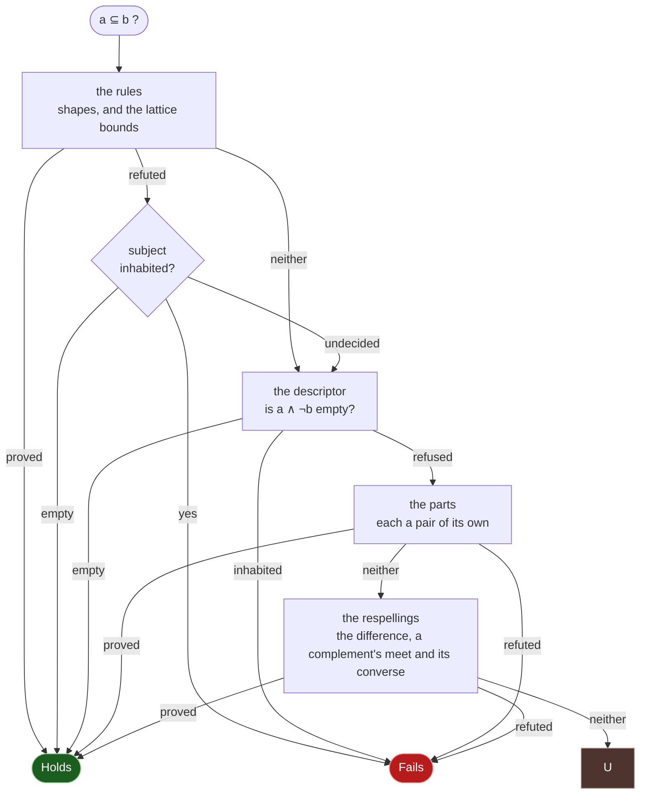

# The decision procedure

Two sound deciders answer the three relations, with reaches that overlap and
neither contains, and the order between them is a cost measurement rather than a
preference.

`crates/valgebra-core/src/descr/` is the **set representation**. A schema
denotes a set; each kind carries a representation closed under union,
intersection and complement; and `a <= b` is `a & ~b` admitting no value. It
decides every relation between two schemas it can build, and it builds no
cycle, no predicate, no class whose metaclass answers `isinstance`, and nothing
past the three bounds a build is held to.

`crates/valgebra-core/src/decision.rs` is the **structural rules**. They recurse
over the schema tree, matching shapes and applying rules, with one module per
surface beside the file: `decision/emptiness.rs` for the three-valued verdict
every relation reduces to, `decision/readings.rs` for what a pair no rule
decides is read for, `decision/constraints.rs` for a refinement's bounds,
`decision/products.rs` for sequences split across a union,
`decision/records.rs` for keyed maps and attribute records, and
`decision/literals.rs` for tables of constants. Both deciders ask `oracle.rs`,
at the crate root below them, the questions only the bindings can answer. The
rules answer first, and the descriptor answers where they decline -- where they
*decline*, not where they say no: a schema the rules prove inhabited is not
lowered, because a sound second reading cannot overturn a proof, and lowering
one would determinize automata and take products to reach the answer the rules
gave.

That ordering is not a second opinion. Both are asked the same question, both
answer in three values -- proved, refuted, or neither -- and both are sound, so
where both decide they agree, the descriptor is asked only where the rules
reach the third, and the pair gives whichever of them decides. Neither is an
optimization of the other: every recursive schema, predicate and hooked class
is the rules' alone ("Why every rule stays", below), and a pair the rules
decline is the descriptor's. Where both reach, the rules go first because
building a set representation costs about three orders of magnitude more than a
rule that already answers (under "The bounds, each measured"), which is what a
relation the rules *refute* stops paying. `tests/test_completeness_probe.py`
asks both of every pair of one corpus and holds the pairs they answer apart --
each a fixpoint the rules' coinductive hypothesis proves and one unfolding does
not -- to a count that may only shrink. [01-schema-ir.md](01-schema-ir.md)
records the order under "Which representation decides".

**How the two deciders compose.** Each answers in three values, and the whole
of the wiring is which answer passes to what. The cascade of *readings* inside
the rules is a sequence and is written out below; what is not a sequence is
this:

Four places carry the design. The **witness guard** is the `W` diamond, and it
has three exits rather than two: a refutation whose subject is proved empty
becomes the *opposite* answer, which is what puts the empty set below
everything, and one whose subject is undecided becomes a decline rather than a
`Fails`, which the descriptor is asked about as it is about any other. The
**descriptor** is reached only from a decline -- a pair the rules
refuted is never lowered, because a sound second reading cannot overturn a
proof, and lowering one costs about three orders of magnitude more than the rule
that already answered. Its inhabited answer refutes only where no reference was
cut: where one was, the difference was widened on the left and shrunk on the
right, so a value found in it need be no value of the real difference -- at
the kinds the cut reaches. A cut beneath a constructor reaches that
constructor's kind alone (`parts_a_cut_reaches`), the difference being read a
kind at a time, so a value it holds at another kind refutes. A cut beneath an
attribute record reaches every kind, whatever constructor stands between the
two, since the record holds values of them all. An inhabited reading that
refutes nothing hands the pair to the same difference cut the other way, the
subject narrowed and the supertype widened (`refuted_narrowed`), which lies
inside the real one: a value it holds refutes at any kind. A
conjunct at the top of the subject no lowering reads -- a refinement's
predicate, a meet member holding one, a meet member nested past the depth
bound, and last a member nested past it by a clause's key alone, which the
build reads without descending -- is left out the same way (`read_widened` in
`descr/lower.rs`): a meet
is below each member, so the reading is a superset, which makes the
descriptor's emptiness monotone in a meet's members, and an inhabited reading
of it refutes nothing. Each reading is decided where it is built, and one that
answers nothing hands the pair to the next. A scalar nested past the depth is
read first by the readings that leave its member out, which build less, and in
the whole build after them, where the caller can read what that build may
answer: an emptiness the rules find inhabited is not built whole. A constraint no component holds that is no predicate --
a fractional step over the floats -- refuses the reading as it refuses the schema. The
depth is read off the schema before anything is built (`nests_past_the_depth`),
so a schema past it costs a walk of the nodes ahead of the deep one rather than
the sets built from them, and a reading that can only be inhabited -- one
conjunct holding a value by its shape -- is built only for a relation whose
supertype lowers, the one question it answers. Its
empty answer has the mirror condition: a literal key is read as a label, which
also holds the subclass keys equal to it, so an empty difference proves the
inclusion only where no such label is subtracted from a dict that can hold a
subclass key (`an_empty_reading_stands` in `descr/lower.rs`). A union of
literal keys is read as its labels, as each literal alone is, and
`a_union_of_literal_keys_proves_nothing_on_the_narrowed_side` holds that arm
on its own, since the property that draws such keys can miss it.

**The parts** are reached only where both deciders declined the pair whole
(`decided_by_parts`), and each part is asked through the whole chart again. A
union subject is asked a member at a time, since it is below where each member
is and outside where one is; a union supertype is narrowed to the branches the
subject shares a value with, by the reading `below_a_union` narrows with, and
the narrowed pair asked whole, or, where nothing narrows, proved by a branch
the descriptor places the subject in, a branch of one constant left out, since
it holds a subject of that one value alone and such a subject is inside every
branch it shares the value with; a meet supertype is asked a member at a
time, since the subject is below it where it is below each member and outside
it where it is outside one, by either decider, beside a member neither reads.
The rules asked each member already, at the root of the query, where no
hypothesis is open, so what they answered is kept beside the query, by its
number, and read back rather than asked again: the members they placed, for a
meet supertype (`below_each_member_at_the_root`) and a union subject alike
(`each_member_below_at_the_root`), and the branches they refuted the subject
below, for a union supertype (`each_branch_at_the_root`), whose by-branch
reading lowers no such branch, since both deciders are sound and a containment
the rules refuted is one the set representation never proves. Asked again, a
meet of records costs the query a second time, and a union of refined integers
drawn eight deep half of it; lowered again, the four branches a list of at least
255 items is refuted below cost a list of six length bounds 20 ms, against 1.2
ms on a reading that asked no part. The two kinds of member are kept apart, so a
record read by a pair it does not name, as the reverse direction of an
equivalence can, reads no member placed and no branch refuted.
What it reaches is the descriptor's
bounds: a union of tagged records is past the node bound as a pair and a record
and the one branch it meets are not, and a branch holding a reference beside a
pattern is dropped where the subject meets it nowhere, which leaves the
descriptor a pair it can refute. The parts share the query's budget, so the
rules stay bounded in total, and the lowerings are counted: one per member and
per narrowing, the supertype of a union subject lowered first to learn whether
it lowers at all, so a supertype past the bounds is one refusal rather than one
a member, and a branch asked alone only for a subject that is not itself a
member. Asked a constant at a time, a table of a thousand names lowered a
pattern a thousand times and decided nothing. No step counts a lowering, so the
parts are asked only while the query has a step left: a pair the rules spent
the budget on has as many parts as members and branches, and a union of four
thousand records against another, or a tuple against its two thousand corners,
read a part at a time cost seventy times the decline and answered nothing
more. A branch the rules refuted is one the sets never prove, so it is not lowered:
read back from the root's record where the union fits it, and asked again where it
is wider, which spends a step where a lowering rebuilds the subject, 512 frozensets
of a literal reading 512 lowerings of 513 nodes for no answer.
`a_union_is_decided_a_part_at_a_time` holds each exit,
`a_meet_supertype_is_decided_a_member_at_a_time` the meet's,
`a_branch_the_rules_refute_is_not_lowered` the union supertype's record, and
`a_spent_query_asks_no_part` the step the parts need.

**The respellings** are reached last, for the query's own pair, where every
decider declined it (`decided_as_respelled`). `a ⊆ b` is `a ∧ ¬b = ∅`, and the
rules are written for the shape a pair arrives in, so the same question spelled
another way reaches arms the first did not. A difference that holds every value
of some kind refutes the pair, read off the two terms with no meet built: the
kind refutation `spills_a_kind` asks of the universe and a complement alone,
asked here of any subject. Against a complement `¬c` the meet `a ∧ c` is asked
below the empty set and the pair as `c ⊆ ¬a`, both goals over the query's signed
subterms, and where both decline, the meet is read empty as `is_empty` reads a
set (`empty_under`): a union a member at a time, each by the rules and by the
set representation. So `anything ⊆ ¬s` is proved where `s` is read empty within
the respelling's steps, which `below_nothing_exactly_where_read_empty` in
`laws.rs` holds over drawn schemas, and
`the_universe_is_below_the_complement_of_a_set_read_empty` on a union neither
reading empties whole. And `a ⊆ ¬c` is refuted where `a ⊆ c` is proved past the
rules, by the set representation and the readings after it under the
respelling's allowance, and `a` holds a value: the rules' complement arm reads
the same from its own proof, which a constant record below a record of patterns
over the JSON values never reaches (`inside_what_it_complements`, read after the
parts of the pair and for each conjunct of a meet supertype). Against a union
holding a complement, `b ∪ ¬c`, the meet
`a ∧ c` is asked below `b`, and where that declines, `a ∧ ¬(b ∪ ¬c)` is read
empty the same way, which folds no predicate's complement:
`what_is_read_empty_bounds_the_relation` holds the relation to what that reading
says. The difference against any other supertype is not asked: a meet built on
every declined pair costs the relation matrix more than it decides. A meet
subject against a meet supertype is the one pair asked as the
two together: their meet proved empty and the subject proved to hold a value
refute it, since `a ⊆ b` with `a ∧ b = ∅` holds only of an empty `a`, and
neither the member rule on the left nor the member-at-a-time rule on the right
reads the two meets at once. The rules asked again share `RESPELLING` steps of
what the query has left, so a pair that declined cheaply does not decline
dearly; `a_pair_declined_as_written_is_asked_in_its_other_spellings` and
`a_respelled_pair_stops_at_its_allowance` hold the readings and the allowance. A
root question that ends undecided at a bound, with steps of its own left, is
asked once more under `RESPELLING_AGAIN` and a `DECISION_BUDGET` of its own
(`asked_again`), so a query spends at most two budgets: answers sat a few steps
under the first allowance, so a sound reading added beside the others lost them,
and a larger first allowance loses answers of its own, a respelling charged to
the query spending steps the readings after it decided with. The first asking's
answer stands wherever it decides, so the second takes none away
(`a_question_declined_at_a_bound_is_asked_again_with_more`).

**A refutation stands on a value.** The descriptor's is direct: it proves the
difference `a & ~b` holds one. A rule's is a mismatch of shapes -- two arities
that cannot align, a key one side requires and the other does not declare --
and the value it names is implicit, *some* value of the subject shaped the way
the subject says. A subject with no value names none, and the empty set is
below every set including the shape it can never take, so a rule's refutation is
read against the subject's own emptiness before it is believed: proved inhabited
it refutes, proved empty it establishes the opposite, and undecided it decides
nothing and the descriptor is asked.

**The reading is taken where the refutation is made**, at every level of a
query and not once at its top. A composition carries a part's refutation up,
and the part is a subject of its own: a list of an element with no value is the
empty list, which is below a list of anything, and the mismatch its element
reports is about no value. The subject one level up says nothing about that --
it has the empty list, whatever its element admits. The shapes whose own form
names a value are read without a descent, which is what keeps the cost of
reading at every level near the cost of reading once: a scalar atom, a
container that admits an empty one, a keyed map that requires no key, a union
with such a member. `laws.rs` holds that shallow reading to the value corpus,
and `decision/tests.rs` pins its edge.

**A pair no rule decided is worth three kinds of reading**, in this order, and
every arm that answers for a shape and then declines hands its pair to them
rather than ending the match: the readings that refute on a value, the last of
them two sets that *share no value* (`unstructured` in `decision.rs` asks the
four any pair can take, and [What a refutation stands on](#what-a-refutation-stands-on)
lists every one with the rule that asks it);
then the oracle, the only reader of a class or a constant; then the supertype's
own shape, where a **refinement** takes its base's refutation and not its proof --
the value outside the base is outside a subset of it, while being inside the
base says nothing about the constraints. The oracle is asked before the
refinement because it proves where the refinement reading only refutes: a
literal below a predicate refinement is settled by running the predicate on the
constant, where the constant is the literal's one value, or where its equality
is one the atoms read through and the supertype asks nothing else that tells
two equal values apart (`the_constant_speaks_for_the_literal` in
`decision/literals.rs`).

**A string subject is read by its texts last**, once the sets have declined
as well (`decided_by_its_texts` in `decision/readings.rs`). A pattern whose
table is past the build's limit -- a counted Unicode class under a repetition --
has no set, and the walk's own matcher answers for one text of it as it answers
for a literal's constant: the oracle walks each text as a `str`, through the
subject and then the supertype (`strings_admitted`). The texts are every word of
one of the subject's patterns whose table builds and holds at most
`TEXTS_READ`, and otherwise a guess at a text of each pattern read off its tree,
which names nothing where the walk refuses it -- `a\bb` guesses `ab`. A text
the subject admits and the supertype refuses is a value outside it. A proof
needs every text, and both sides judging two `str`s of one text alike, since a
`str` subclass with the same text is a value of the subject the walk was not
shown.

Both halves are gated. `scripts/perf_gate.py --decision` measures the relations
that hold; `--decision-refute` measures the ones a rule refutes, which is the
path the first workload never walks and where work therefore costs nothing any
budget holds. `Validator.relation_to` is the boundary's reading of the same
three values, and `tests/test_completeness_probe.py` holds a reported refutation
to naming a value its universe contains.

## What the descriptor is made of

The shape is three layers deep, and reading it in that order is what makes the
bounds in [00-architecture.md](00-architecture.md) legible: each one belongs to
exactly one layer.

**A descriptor is twelve slots.** `Descr` in
`crates/valgebra-core/src/descr/mod.rs` holds one per `Kind` -- eleven -- plus a
**kindless** slot for the values no
listed kind covers: a callable, a generator, an instance of a class deriving from
no builtin. The slot exists so that a complement means what it says; without it
`complement(int)` would name only the ten other kinds. Union, intersection and
complement run slot by slot, which is the whole reason to partition first: no
rule has to relate a list to an int, because the two never share a slot.

**A slot is a union of lines.** A class and an attribute record constrain a
value *within* its kind rather than instead of it -- a dataclass deriving from
`int` has an integer's structure *and* a class -- so `descr/lines.rs` carries
each slot as `⋁ᵢ (structureᵢ ∧ classesᵢ ∧ attrsᵢ)`. That is a disjunctive normal
form *inside* one kind, over a handful of lines, rather than over all twelve
slots at once. A literal is a line with a class: its constant met with
`Class::exact`, the builtin's own type, which nothing derives from and every
subclass of the builtin is laid out apart from. `descr/classes.rs` holds the
class order as a **snapshot**, because the core cannot call `issubclass` and
should not want to: `ABC.register` can change that relation after a schema is
built, and a relation that moves is not a lattice to reason in. Beside the order
the snapshot carries what a *direct* instance can hold (`Attributes`): the names
the `__mro__` defines and whether each is a slot, a plain definition or a data
descriptor, whether the instances carry a `__dict__`, and which attribute hook
the class defines. `Attributes::reach` turns those into one answer per name,
which is the only place they are read: the atom's emptiness asks it through the
snapshot, and the rules' reading of a class met with a record asks it through
`LeafRelations::attribute_reach`, which the bindings answer from the same
reading, cached once per class for the query (`oracle.rs`). The names are one
`Namespace` per class on the `__mro__`, shared by every class standing on it
rather than copied into each. The namespaces of `object`, of the builtins a kind
is read from and of `BaseException` are static types no assignment reaches, so
the bindings read them once per process, and every other namespace once per
query. A namespace and the order are read through `type`'s own descriptors, as
`inspect.getattr_static` reads them (`namespace_by_type` and `mro_of` in
`oracle.rs`), and a hook where Python's special-method lookup finds it
(`special_lookup`): Python dispatches `isinstance`, `==`, `len` and `iter`
through the type's own namespaces and asks no `__getattribute__`, the
metaclass's included, so a metaclass answering `getattr` hides nothing.
Assigning to a class after the snapshot moves the facts as `ABC.register` moves
the order. `descr/records.rs` holds the attributes as a union of always-open
record atoms, a field's type living in `T⊥` so that optionality is membership
rather than a flag with rules of its own.

**A line's structure is one component per representation**, not one per kind, so
two kinds that hold their values alike share one:

| Component | Serves | Representation | Module |
|---|---|---|---|
| `Booleans` | `bool` | a two-bit subset, which is exact for a kind with two values | `descr/mod.rs` |
| `Integers` | `int` | eventually periodic sets: an interval set per residue class, which is what holds a bound, a point *and* a step | `descr/integers.rs` |
| `Floats` | `float` | closed intervals of floats, an open end held as its neighboring float, per residue of a whole step where one split the line and beside the floats no step holds, plus a bit for `nan`, which sits outside the order | `descr/floats.rs` |
| `Words` | `str`, `bytes` | a minimal deterministic automaton, canonically numbered, so two spellings of one language are one table | `descr/regular.rs` |
| `Sequences` | `list`, `tuple` | an automaton whose transitions are guarded by value sets -- the letters are descriptors, so the component recurses through the automaton's *states* | `descr/symbolic.rs` |
| `Sets` | `set`, `frozenset` | a union of powerset lines: a set is its members and has no order for an automaton to walk | `descr/sets.rs` |
| `Maps` | `dict` | a union of map atoms -- finitely many named keys plus a per-kind default, a split of the `str` part by regular languages where a clause narrows its keys, and a negative set | `descr/maps.rs` |
| `Coarse` | `NoneType`, the kindless slot | every value of the kind or none, which is **exact** where the kind has one value | `descr/mod.rs` |

**A fractional step stays out of `Floats`, on its figures.** A dyadic step such as `0.25`
is a table over a finer grid, so the component could hold one, and it would carry that grid
through every reading of a stretch and re-fit a set's classes where a meet moves it. Of the
243 `multipleOf` in the 9,558 schemas of JSONSchemaBench, 3 are dyadic, all `0.25`, against
154 decimal steps no grid holds and 86 whole ones, so it would decide for almost nobody and
leave the step callers write, `0.01`, where it is. A proposal starts from those figures.

`Component::top` is the one place that says which kind takes which
representation, and it is the sentence to read rather than this table. Every
listed kind has a representation that separates its values; `Coarse` survives
only where it is exact.

**Both automata hold the state bound as they are built** (`MAX_STATES` in
`descr/automaton.rs`). A product and a compiled pattern are numbered by a walk
that refuses the state past it. A literal word and a sequence shape are built
as chains, and `chain_fits` asks before the chain is built, so a literal of a
million characters declines for one comparison rather than after a table of a
million states. A leaf past the bound buys no answer, since the first product
it meets refuses.

**A thread builds a pattern's table once** (`RegularSet::compile` in
`descr/regular.rs`). A lowering reads a schema's patterns and length bounds again
for every difference it is asked, and a build is a function of the text and the
alphabet alone, so a thread keeps each language it built under the text it was
built from, a refusal among them, and hands it back for that text again,
found before the text is parsed. A length bound's counted table, built
directly rather than compiled, is kept the same way under the text the compiler
would build it from (`RegularSet::counted`), which
`a_counted_symbol_is_the_table_the_compiler_builds` holds to the compiled
table, so the key names one language whichever route reads it: a relation
reading `MaxLen(500)` beside a pattern rebuilt and minimized that table each
time it was asked again, most of a millisecond, and reads it back in five
microseconds (`a_counted_table_is_kept_under_the_compilers_text`). The memo is
bounded by the bytes it holds, `COMPILED_BYTES`, and starts over past it.

**A thread builds a product of two tables once** (`Products` in
`descr/regular.rs`). A meet or a join of two languages is a function of the two
tables and the operation, since each table is minimal and canonically numbered,
and a relation over records keyed by strings meets the same few key sets over
and over: one between two records nested past the depth the sets descend builds
nine thousand products of thirteen hundred pairs. The memo is keyed by the two
tables' addresses and holds both tables, so an address it holds is not reused
while it is held; meet and join commute, so a pair is keyed in address order,
and a product refused past `MAX_STATES` is held as the refusal it is. It is
bounded by `COMPILED_BYTES` as the language memo is. The relations asked of the
sets read 29% fewer instructions with it, and the length bounds 5%.
`a_product_of_two_tables_is_built_once` in `descr/regular/tests.rs` holds it.
A complement, a word and an order bound are built anew on every ask, so a
thread hands a table it builds again the handle the first one got (`Handles`):
two tables of one language are equal, being minimal and canonically numbered,
and one language is then one address, which the product memo's key needs. A
relation holding a string bound beside a pattern of `\w` reads in 4 ms asked
again, against 25 ms with a product built on each complement anew, and the
relations asked of the sets read 25% fewer instructions again, the length
bounds 5%. `a_table_built_again_is_handed_the_first_ones_handle` holds it, and
the memo is bounded by `COMPILED_BYTES` too.

**A map's key lands in the parts of the key partition it holds whole**
(`key_cover` in `descr/lower.rs`): a kind, a `tuple` or `frozenset` of
anything, a union of those, and a complement of one, which opens the parts its
inner leaves -- the part for a key of no listed kind among them, so
`complement(str)` holds `{object(): 1}`. A literal is a label. A `str` narrowed
by a pattern or a length, and the connectives over those (`narrowed_cover`),
splits the `str` part by the regular language it spells, so the default stays a
function, on a finer partition: an atom holds its own split, a meet reads two at
their common refinement, and a constraint over a cell holding few keys is pinned
to them as one over a finite part is (`over_a_split` in `descr/maps.rs`). The rules
read such a key as one they cannot place, a proof or nothing. A key holding any
other part of a kind -- a narrower tuple, a class, the complement of a literal --
refuses, because no split holds it; [15-decidability.md](../15-decidability.md)
lists what that leaves to the rules. A want indexed past the partition -- no lowering builds one, so it is an
invariant broken -- is no element of the model, and an atom carrying it is
proved nothing: its emptiness declines, and its complement keeps the want, so
every reading built from it declines too
(`a_want_past_the_partition_proves_nothing`).

**A pattern is a set of strings, whatever its base.** `refine` in
`descr/lower.rs` meets the base with the set each constraint denotes, and a
`Regex` matches the text of a `str`: the walk refuses every other value,
`bytes` among them, so the set is the pattern's language over `str` alone and
the meet drops what the base does not hold. Read over `bytes` as well,
`Annotated[str | bytes, Regex("a*")]` would hold `b""`, and a set wider than
the schema on the supertype side proves an inclusion a value refutes:
`Annotated[bytes, MaxLen(0)]` below it. A base holding no string meets the
pattern in nothing, answered before the automaton is built.
`a_patterns_set_holds_only_strings` in `laws.rs` draws the base over the
structural fragment.

**A refinement in a meet is read within the members that lower.** `descend`
lowers a meet a member at a time, and a bound over a base holding kinds it
cannot count refuses alone: a length over `object` holds sets, dicts and values
with no length. Where a meet fails so, `refinements_within_the_rest` lowers the
members that lower and meets each refinement's base, or the base of a
complemented one, with them before its constraints are read. `R ∩ (B ∩ C)` is
`R ∩ ((B ∩ R) ∩ C)` [FCB08, Def. 4.1], so `intersection(str, Annotated[object,
MinLen(2)])` lowers to the set `Annotated[str, MinLen(2)]` does, and met with a
set or a dict the length still refuses. The reading is exact and asked only
after the member-by-member reading refused, so a meet that lowers pays nothing
for it. It is a reading, where `01-schema-ir.md` refuses the fold that would make
the meet one refinement in the constructor.
`a_bound_met_with_a_base_is_the_base_under_the_bound` in `descr/lower/tests.rs`
holds the two spellings to one set.

**The rules read a pattern over two bases as one set.** `Refine(str, C)` and
`Refine(Anything, C)`, `C` holding a pattern, denote the strings `C` admits, and
so does a refinement by the same constraints over any base that holds every
string. The fold that empties a meet compares spellings and reads the two as two
sets, while the set reading lowers both to one language, so a union of one with
the other's complement is the universe to the set reading alone, and below a
subject that reading cannot lower the pair would decline. The emptiness rules
read a refinement and the complement of one with the same constraints, a pattern
among them, as meeting in nothing where the complemented base holds every string
(`has_a_pattern_and_its_complement` in `decision/emptiness.rs`). The constraints
are read as a set first, since a predicate may answer two occurrences apart.
`fuzz/seeds/decision/` keeps the input,
`a_pattern_over_two_bases_that_hold_every_string_is_one_set` in
`decision/tests.rs` holds the pair and two neighbors that stay inhabited, and
`a_universe_through_a_pattern_over_two_bases_bounds_a_subject_the_sets_refuse`
in `laws.rs` draws the family.

**A union holding the top lowers to the universe, whatever else it holds.**
`X ∪ ⊤` is `⊤`, so a member the lowering refuses -- a literal the pool cannot
read, a predicate -- refuses no union beside the top. The constructors fold
such a union, and a term built raw carries it; the lowering looks for the top
only where a member refused, so a union that lowers pays nothing for the look.
The fuzzer drew `None | <literal> | Any`, through a reference, below a union the
set reading proves universal because no string fully matches two of its
patterns, which the rules compare by spelling: the relation declined a subject
whose own reading is the universe. `fuzz/seeds/decision/` keeps the input,
`a_union_holding_the_top_is_below_a_universe_the_sets_prove` in
`decision/tests.rs` holds the pair, and
`a_union_holding_the_top_lowers_to_the_universe` in `descr/lower/tests.rs`
draws the family. A lone literal the pool cannot read below the same union
stays a decline: the set reading lowers no supertype for a subject it refuses,
the dearer route below.

**What no component holds is a cycle**, which is why a recursive schema is
lowered by unfolding its body once, with a lattice bound where the reference was
(`UNFOLDS` in `descr/lower.rs`), and belongs to the rules past that. The other
refusals are size: each representation has a ceiling it will not exceed, because
a union too wide is complemented into one too *narrow*, so rounding is never the
alternative to refusing. `descr/budget.rs` bounds the work spent reaching a
result, which is a different quantity from the size of one.

**The difference a relation asks for is a build of its own**, under that same
allowance. It is the dearest of the three a relation makes -- the two sides come
off a schema the node bound has already measured, and the difference multiplies
a complement against a meet -- and it is the one nothing else holds: a width
bound refuses an answer too wide to represent, and says nothing about how long
reaching a narrow one may take. So the allowance is what sets the width of the
fragment the sets decide, and `decision/tests.rs` carries the two record splits
either side of it, asked of the set reading alone: a record over sixteen
corners decides, one over twenty-five declines, and a decline is "not proven within what a
build may spend". The record rule decides both, so the figure is the set
reading's and not the relation's.

**So is the reading of a side.** A subject is read for emptiness before the
difference is built, and a negated union's emptiness expands it by a product,
which costs what a build costs. `read_widened` decides each reading under an
allowance of its own, the same figure: read outside one, the complement of a
meet of three complemented records multiplied out for minutes where it now
declines at once (`each_reading_is_decided_under_an_allowance_of_its_own`).

**Against a complement, the difference meets the inner set.** `a ∧ ¬¬x` is
`a ∧ x`, and `x` is lowered on the widened side in place of complementing the
lowered `¬x`. The double negation is not free: where `¬x` expands -- a record
whose field spans two kinds expands into more atoms than it began with -- the
meet with the rebuilt set spends past the allowance a meet with `x` fits in, so
`{"t": int} ⊆ ¬({"t": str} ∪ {"t": bytes})` would decline while one and three
field kinds decide. `decision/tests.rs` holds the widths from one to four.

**A ceiling reached by one spelling of a set and not another is a ceiling that
decides relations.** The four lattices built from parts -- a kind's lines and
the map, object and set lattices -- hold a set as a union of summands under a
polarity, one device in `descr/polar.rs` with each lattice saying only what a
summand is, so a complement that does not fit as a union is held as the
negation of one; the union is rebuilt when something meets it. Rebuilding it
*first* is what passes the ceiling: `¬⋁ᵢAᵢ` is `⋀ᵢ¬Aᵢ`, and multiplying every
`¬Aᵢ` together before anything narrows the product reaches the widest term the
question has, which is rarely the answer's width. So a meet against a negated
union removes one `Aᵢ` at a time from what it already holds. Both orders
compute the same set -- the budget's own rule is that it may turn an answer
into a refusal and never one answer into a different one -- and only one of
them asks the ceiling about an intermediate nobody wanted.

`descr/lower.rs` is the map from a term to a set, and the two live side by side
rather than one replacing the other: the walk decides membership, and the
descriptor is what the algebra reasons in. So the descriptor's own membership --
`Value`, `Descr::admits` and the `holds` of every component but the boolean,
integer and interval sets -- compiles under `cfg(test)` alone: no relation asks
whether a value is a member, and the laws hold every operation to it. Those
three ship because lowering asks which values a set holds. The components are crate-private, so a part no
relation reaches is dead code the compiler reports.

## Why every rule stays

A rule earns its place by reaching a shape the descriptor refuses, or by
answering a common one far more cheaply. The first is the load-bearing half, and
the refusals are wide: the descriptor holds no cycle, so **every recursive
schema** is the rules' alone; it holds no predicate and no class whose metaclass
answers `isinstance`; and it refuses any schema past the three bounds a build is
held to.

That is not an argument, it is a measurement. Deleting the float arm of the
region partition takes out two lattice laws and a membership law. Deleting the
contravariance arm -- `~A <= ~B` is `B <= A` -- takes out *reflexivity*, because
a complemented recursive schema has no other route. Deleting the sequence arm of
the emptiness fold takes out the rule that a sequence is empty when a prefix
element is. And every survivor a full sweep of the file leaves is accepted in
`scripts/mutation_baseline.json` with the argument for it; the nightly ratchet
holds that set in both directions, so no arm is dead weight and no accepted
survivor outlives the rule it was written about.

A rule the descriptor also decides is invisible through the public relation, so a
test about a rule's *scope* has to ask the rule. `decision.rs`'s own test module
(`decision/tests.rs`) carries `by_the_rules` and `empty_by_the_rules` for that,
and asks `Schema::subtype_relation` and `verdict_under` directly where a test
needs the rules' three-valued answer rather than their proof.

## Sound, not complete, and the direction matters

Every relation is **sound**: a `true` is a proof, a `false` means "not proven".
`is_subtype_of(a, b)` returning true asserts set inclusion; returning false
asserts nothing beyond the procedure's reach.

That asymmetry is deliberate and it is what makes the procedure safe to extend.
Adding a rule can only move answers from false to true, so no extension can make
an accept wrong. The published boundary is `docs/15-decidability.md`; the enumerated
relations the procedure is required to *decide* are
`tests/test_completeness_ledger.py`, which holds the decided list in both
directions — a relation that regresses to conservatism fails, and a closed hole
whose ledger entry survives fails too.

The ledger only holds relations someone thought to write down, so it is one half.
`tests/test_completeness_probe.py` is the other: it searches for pairs answered
`false` that no value in a wide universe refutes, and fails when one appears that
is not written down with a reason. An enumerated list can only confirm the rules
it was built from; a search can report a rule nobody wrote.

## The scalar fragment is exact, through a region partition

Two partitions of the value universe live in `kind.rs`, below both deciders,
and they are not rivals: `Kind` is the eleven-part one the descriptor's
components are indexed by, and `Region` is a seven-bit *summary* derived from
it (`Kind::region`) -- six scalar bits and one for everything else. The rules
reason in the summary because that is all a bitset needs to decide a scalar; the
descriptor reasons in the partition because a component per kind is what closes
each under complement.
A change to one is a change to the other, in that direction only.

The value universe is cut into mutually disjoint regions, and a Boolean
combination of scalar atoms denotes a set the lattice operations compute
exactly. On that fragment emptiness and subtyping are decided completely:
subtyping **is** set inclusion between two region sets, and nothing else.

`Region` carries the operations — `union`, `intersect`, `complement`,
`is_empty`, `subset_of` — rather than leaving `|`, `&` and `!` at the call sites.
That is a correctness decision as much as a clarity one: the one-character
difference between a right and a wrong operator sat inside folds no test could
distinguish it in, and concentrating them into five methods put each in a place a
test reaches. [06-type-design.md](06-type-design.md) records what that moved.

Six scalar regions and one non-scalar remainder partition the universe. The
remainder is what keeps emptiness sound: the meet of all six scalar complements
is the non-empty non-scalar region, not the empty set. A test asserts the six are
non-empty and pairwise disjoint, because either half alone is satisfied by a
region that collapsed to nothing.

Off that fragment a schema's regions are `Regions::Unknown` — opaque, and
absorbing under both lattice operations. Literals, instances,
refinements, content-bearing containers and references are all opaque.

A combination holding one is read two ways, and which way depends on what the
answer is for. The **fast** reading stops at the first opaque member, because it
is taken of every pair and a union of a thousand literals is a thousand opaque
members to walk rather than one to stop at. That reading is incomplete in one
direction: a union carrying a schema beside its own complement covers the
universe whatever else is in it, and stopping on the "whatever else" misses it —
so the same three members read as the universe in one order and as unknown in
another. The **complete** reading walks every member and carries what they name
between them, which no pairwise step can, and it is asked once, for a pair every
rule has already declined. A query that decides never pays for it. A union's
verdict is split the same way: every asking but the last stops at the first member
not proven empty, and the last reads on to a member holding a value, which a
refutation of the union stands on. The members' order is their pooled constants',
so without it a refutation turned on which constant was pooled first; read on in
every asking, it cost a JSON value's law six times its instructions.

It is asked of a **union** and of nothing else, because a union is the only
shape that folds a member list and so the only one with a stop to read past. A
meet covers the universe only when every member does, and the rule for a meet on
the right asks each member on its own; a complement covers it only when the
schema under it holds no value, which the complement rule already asks. An arm
for either is indistinguishable from its own deletion, which the mutation sweep
reads as a survivor.

The constructors do not take the complete reading. `Schema::union_within` in
`ir.rs` folds a union to `anything` only where it carries a complement beside
its inner schema, or beside every member of the union under it
(`has_complementary_pair_within`), so a union whose readable members cover every
region between them stays a union: `int | str | list[int] | (~int & ~str)` is
spelled and kept, the fast reading stops at the
list, and the complete reading is what decides it -- as it decides the terms the
fuzz target builds by hand.

## What the core cannot decide alone

A class hierarchy and a concrete value are Python facts, and `valgebra-core`
cannot see Python ([00-architecture.md](00-architecture.md)). The `LeafRelations`
trait is how it asks, `oracle.rs` is where the core asks it, and
`crates/valgebra-py/src/oracle.rs` is the answer the bindings give — the two
sides of one seam, each in a module named for it, the binding's side with a
corpus of its own driving every question below
(`oracle/interpreter.rs`, [08-testing.md](08-testing.md)). The questions:

- `leaf_subtype` — is this literal a member of that set, is this class a subclass
  of that one, is `None`, the one value of its kind, a member of it;
- `literal_sets_disjoint` — do these two *sets* of constants share a value. The
  same relation `literals_disjoint` answers for one pair, asked of every pair at
  once: the core compares a union with a union member by member, which is
  quadratic in the oracle, and two twenty-thousand-member literal unions are
  four hundred million calls. An implementor that can hash its
  constants answers in one pass; the default declines and the member walk
  stands. A table below the complement of another is the same question, asked
  before the union rule distributes the subject (`tables_disjoint`);
- `literals_disjoint` — do these two constants share a value, the one-pair form
  of the question above;
- `literals_paired` — which pairs of constants, one from each set, share a
  value. What two discriminated unions ask of their tags: each record pins a
  required key to a constant, a pair pinned to constants apart is disjoint by
  that key, so only the pairs named are read whole (`tag_pairs` in
  `decision/readings.rs`): the disjointness reading of the two unions, and a
  union below the complement of the other (`union_below`), which reads only the
  members a pair names. Read a pair at a time, two unions of sixteen hundred
  records are two and a half million `literals_disjoint` calls and a quarter of
  a second, and read at the tag about a millisecond. An implementor that can
  hash its constants answers in one pass; the default declines and the pairs
  stand;
- `literals_counted_apart` — how many values these constants of one kind hold
  apart under `==`, which is how many members a set drawn from their literals
  can reach before a length bound is read against it (`literals_apart`). The
  same relation `literals_disjoint` answers a pair at a time, so n constants
  are n squared questions. An implementor that can hash its constants under an
  equality it trusts counts them in one pass; the default declines and the
  pairs stand;
- `constant_is_alone` — is this constant the only value its literal denotes,
  which decides whether `leaf_subtype`'s proof by the constant speaks for the
  literal before a predicate or an attribute record
  (`the_constant_speaks_for_the_literal`). The default answers no, which keeps
  such a proof only where the supertype tells no two equal values apart;
- `equal_values_read_alike` — do the values `==` joins to this constant answer
  a pattern, a length, a bound and a step alike, which decides whether that
  proof speaks for the literal before any other atom. Those atoms read a
  builtin's storage, so a builtin subclass whose `__eq__` is its own -- a
  case-insensitive `str` -- joins values they read apart, while an exact
  builtin, a subclass keeping the builtin's `__eq__`, a standard-library value
  type and a type comparing by identity read alike. The default answers no, which
  keeps the proof only where the constant is alone;
- `strings_admitted` — which of these texts, each a `str`, does this schema
  admit, by the walk a validator of it runs: the question `leaf_subtype` asks
  of a literal's constant, asked of the texts a string subject is read by
  where its pattern's table is past the build's limit (`decided_by_its_texts`);
- `compare` — order two pooled refinement bounds. An operand the walk reads
  through another order declines: `x >= b` reads a builtin subclass's operand
  through the builtin's storage, or through the reflected method the subclass
  overrides, so a subclass with an `__eq__` or an order of its own -- `Mod7(1)
  == 8` -- is one bound to `==` and another to membership. A class of no
  builtin declines unless it is exactly one of the standard library's value
  types the trust base names: Python implies no relationship among its
  comparison operators, and the walk reads `>=` alone. A list or a tuple
  operand declines too: it orders item by item, and a value's item equal to
  one bound's and ordered against nothing -- `2 + 0j` -- passes one bound and
  raises against the other;
- `no_int_between` — does the interval between two bounds admit no integer,
  declining on the same operands, which `floor` and `ceil` round as the builtin,
  and on a `Decimal` whose leading digit sits `ROUNDED_DIGITS` places up or
  past: rounding one to an `int` takes time quadratic in its digits, and its
  exponent can be far past that. Read both ways: `bounds_unsatisfiable` takes
  `Some(true)` as an empty integer refinement, and `bounded_integer_verdict`
  takes `Some(false)` as an integer that is a value of one. The bindings keep
  each answer for the query by the two operands and their strictness, since a
  refinement over the integers is asked it at every verdict the rules read of
  it, and ask a decline again (`oracle.rs`);
- `divides` — does one pooled step divide another, which settles an inclusion
  between two `MultipleOf` refinements: every multiple of `m` is a multiple of
  `s` when `s` divides `m`, whatever the size of either. The operator is `%`,
  asked of the two steps as the walk asks it of a value, so a divisor of any
  numeric type answers by its own rules. The answer carries to the values only
  where `%` reads a value and both steps as one kind of number, which the rule
  reads from the base and `operand_kind` before it asks;
- `operand_kind` — which kind does this bound's or step's value have, read as
  `literal_kind` reads a constant and at any size: an `int` past the machine
  word is an `int`, which the pooled operand cannot carry;
- `literal_kind` — which kind does this constant's value have, which is what
  puts a `Literal` on a kind's line at all;
- `literal_of_no_kind` — is this constant of no kind, its exact type none of the
  kinds' types. Asked beside `literal_kind`, whose `None` is a decline: a constant
  declined may be of any kind, and only one positively of none is outside every
  kind's plain values;
- `atom_denotes_a_set` — does this atom denote a set the order can read. A class
  whose metaclass computes `isinstance` or `issubclass` answers membership by
  running code, and no snapshot of the class order predicts what that code says,
  so every class question below declines on one;
- `class_admits_kind` — can a value of this kind be an instance of that class.
  Asked this way round because a class need not *have* a kind: one laying down
  no layout is declined rather than answered, since `isinstance` reads the whole
  subtree beneath a class and a subclass may derive from a builtin as well. A
  class that does lay one down confines its instances, because Python refuses a
  subclass that would lay down a second: to that builtin's kind where the layout
  is a builtin's, and to no listed kind at all where it is the class's own
  `__slots__` over `object`. `Some(false)` is then a refutation the rules can
  make;
- `direct_instance_of_kind` — does a value whose *type is* this class have that
  kind. The narrower question beside the one above, and the one that can refute
  where it cannot: `class_admits_kind` reads the whole subtree and so must
  decline a class laying down no layout, while a *direct* instance of such a
  class is a plain object and has none of the kinds the partition names. A meet
  of a class and its attributes holds exactly such a value, which is what makes
  the answer a value rather than a guess about which classes exist;
- `kind_derives_from` — is every value of this kind an instance of that class,
  asked of the kind's own builtin so the answer is one `issubclass` over the
  order. The dual of the question above, with the kind and the class swapping
  sides;
- `attribute_reach` — what can this attribute of a *direct* instance of that
  class be: missing or any value, any value, never there, or code's answer
  (`Reach`). Asked before a class met with a record is read as holding the
  direct instance the readings above stand on. The default reads the snapshot
  `Constants::class` gives, which is what the descriptor reads, so the two
  deciders answer from one reading; `None` reads as code's answer, which stands
  nothing on the instance.

**A probe that raised has answered nothing.** Every question above that runs
user code -- a predicate or an `__eq__` a literal is probed with, a comparison,
`%`, a metaclass hook, an enumeration's iteration -- reads a raise as a decline,
which the core folds conservatively. The first fatal signal is kept as well,
and `PoolRelations::answer` hands it back in place of the verdict: read as a
non-member, a predicate interrupted while `Literal[5]` is probed would answer
`not_subset` about a refinement the query never finished asking. `is_empty`,
`is_subtype_of`, `relation_to` and `is_equivalent` each return through it.

**An answer reads Python at the type the trust base grants it for.** Each
question above stands on a reading the trust base
([14-soundness.md](../14-soundness.md)) grants for one case -- an exact
builtin's `==` and order, an enumeration as `EnumMeta` builds it, a class as
Python lays it out when it makes it -- and an object of a neighboring case is
declined rather than read as that one: a builtin subclass with an `__eq__` or
an order of its own (`equal_values_read_alike`, `compare`), a sequence bound
whose items a value's items may not order against, an enumeration whose
`_missing_` or metaclass hooks are its own, a class whose `__slots__` or `mro()`
code writes after the class is made, and a class a module of the program's own
binds under a standard-library name, which the value types are read by identity
with (`ships_with_the_interpreter` in `oracle.rs` places a module by where the
import system loaded it). A rule that reads an answer's negative
side as a refutation states at its site what that negative means for `nan`,
for a class this oracle does not trust, and for a question it declined.

**A layout is the class that laid it down.** The snapshot a class enters the
core with carries, beside its ancestors, the class whose instance layout it has:
the first on its `__base__` chain that lays one down, which is one of the nine
builtins, a class whose own `__slots__` added a slot -- `__dict__` and
`__weakref__` add none, and neither does an empty `__slots__` -- or a static
type defined in C whose instance is larger than its base's, by `__basicsize__`
or `__itemsize__`, the test CPython's `solid_base` puts to a static type
(`lays_down_its_own` in `oracle.rs`). So `complex` lays one down and meets no
kind, and `Exception` lays none, its instance being `BaseException`'s, so
`ValueError` and `TypeError` meet in the class deriving from both. A heap type
defined in C -- `collections.deque`, and `decimal.Decimal` from 3.13 -- is read
by its own `__slots__`, as a class defined in Python is; PyPy names no size, so
there a type defined in C is read by its slots alone. A type defined in C can
derive from a builtin off that chain: `numpy.float64` has `floating` for its
`__base__`, `float` on its order and a `float`'s storage. So a class with no builtin
on the chain takes its kind from a builtin its order names. The two readings are
not alike: a metaclass's `mro()` can leave a builtin out, and
CPython's `mro_check` refuses one that adds a base whose layout the class does not
extend, so what an order names the instance holds. All of it is read off what
Python built rather than off attributes code assigns: `__base__`, the flags and
the sizes through `type`'s own descriptors, the chain Python lays an instance
out along and the one a metaclass's `mro()` does not rewrite, and a slot off the
member descriptor Python made for it when it made the class, since a `__slots__`
named afterwards lays nothing down. A slot whose descriptor an assignment
replaced is read as the value that replaced it. Python builds a class deriving
from two others only where the layout one carries extends the other's, and a
layout extends another when the class that laid it down derives from the class
that laid down the other. So two classes are disjoint exactly when both carry a
layout and neither's is among the other's ancestors, which is what refutes
`MyInt & MyStr` and two slotted classes alike, and lets a plain subclass of a
slotted class meet a slotted subclass of the same base in the class Python
builds from both. PEP 800 names the rule; its `@typing.disjoint_base` decorator
is **not read**, for the reason the PEP gives: "there is no runtime enforcement
of this decorator on user-defined classes". A class deriving from two decorated
classes exists if someone writes it, and a meet called empty on the strength of
the decorator would refuse a value that exists. `tests/test_classes.py` holds
the layout rule to the interpreter over drawn class orders -- a meet is empty
exactly where `type("E", (C, D), {})` raises -- and holds the decorator to
nothing.

`NoLeafRelations` is the core's default and decides nothing: it declines every
question, and that is the contract rather than an omission, because an answer
from it would be a claim about a value the core cannot see.
`the_default_oracle_declines_every_question` in
`crates/valgebra-core/src/oracle/tests.rs` asserts the decline of each default,
so a mutation replacing a default with an answer fails there, and
`.cargo/mutants.toml` excuses no oracle default from the sweep.
`tests/test_oracle_ledger.py` holds both halves: every default that declines is
asserted by that test, and the sweep excuses none.

Which answer a rule reads as a proof belongs to the reader, and one question can
have a reader for each. `no_int_between` has two, so a default answering it
either way decides `int` under bounds the core cannot read: `Some(false)` names
a value under `Ge(inf)`, which holds none, and `Some(true)` empties `Ge(0)` with
`Le(10)`, which holds eleven integers.
`the_core_alone_decides_no_order_bound_over_the_integers` in
`crates/valgebra-core/src/decision/tests.rs` holds that decision to unknown.
`tests/test_oracle_ledger.py` also holds the list above to the trait in both
directions.

## When a class is the union of the values it lists

`leaf_subtype` answers one question the class hierarchy alone cannot: whether an
enumeration is the union of its members. It is, when **every instance of the
class is one of the values `list(cls)` yields** — and that takes six
conditions:

| condition | the value that stands against dropping it |
|---|---|
| it is an `Enum` | — |
| it is **not** a `Flag` | `P.A \| P.B`, an instance of `P` that `list(P)` never yields |
| it has **at least one member** | a subclass's member: a memberless enum is still subclassable |
| its members compare by identity | an `IntEnum` member *is* the integer, so two of them are not two values |
| it makes no instance but by looking a member up: its `_missing_` is `Enum`'s, its metaclass's `__iter__` and `__call__` are `EnumMeta`'s | `E(5)`, which a `_missing_` of its own makes, and a member a metaclass's `__iter__` leaves out of `list(cls)` |
| it has **no subclass**, as `type`'s own `__subclasses__` lists them when asked | an instance of a plain class whose `__bases__` was assigned the enumeration, which a class statement cannot derive from but `CPython` 3.15 lets an assignment do, made by that class's own constructor |

The shorter reading -- "the members are fixed at class creation, a class with
any cannot be subclassed, and every instance is one of them" -- has a true
middle clause and two false outer ones: a flag's `|` operator makes instances
after the class is built, and a class with *no* members is exactly the case the
no-subclassing rule does not cover. Decided as unions on that reading,
`Validator(Flag) <= Literal[*Flag]` and `Validator(EmptyEnum) <= nothing` would
each be `True` with a value refuting it.

**A class read as its members is that union to a refutation as to a proof.**
The rules ask the members where a union or a complement is the supertype, and
the bindings answer `attribute_reach` and the class snapshot for such a class
as they answer a builtin's: no name of a direct instance is read, since an
instance made past the members is no value of the set. A refutation standing
on one would refute `Pair <= ~X` beside `Pair <= Literal[Pair.A, Pair.B]` and
`Literal[Pair.A, Pair.B] <= ~X`, both proved, so no one set gives the three
answers. A meet holding the class is read through the complement law, `C ∧ R`
empty where `C ⊆ ¬R` (`a_class_below_the_complement_beside_it` in
`decision/emptiness.rs`): the class is asked against the complement of the
other members' meet, which the bindings answer a member at a time, so `Pair &
X` is empty where no member carries `x`, as `Pair <= ~X` holds. Only the proof
is read: the walk refuses a value it stopped at from a set and its complement
alike, so a member outside `¬R` need not be in `R`.

A class failing any condition is the `isinstance` atom any other class is. That
costs completeness and nothing else: membership is unaffected, and the relations
stay undecided. `tests/test_enums.py` holds each refused kind to the value
that would refute the union reading, so a kind read as its members again fails
there.

`None`'s kind is the literal of its one value with no condition, since
`NoneType` admits no subclass: it is below a set where the walk admits `None`,
and it is the table of that value where a meet holding it is read one constant
at a time (`a_meet_read_by_its_constants`). `bool`'s two values need no question
here, the parts reading taking the kind a literal at a time. The classes of
`...` and `NotImplemented` admit no subclass and make no second instance, so
the binding's `leaf_subtype` reads each as the literal of its one object too.

## The two routes to a subtype answer, and where they part

`a <= b` is `a & ~b` admitting no value, and there are two procedures that reach
it: the structural rules, and the emptiness of the difference through the
descriptor. Both are sound and neither subsumes the other, so `is_subtype_of`
asks the rules and then the descriptor, and `is_empty` asks its own pair. Below
`nothing` the two are one question, so `is_empty` reads what the relation there
reads where the pair declines: a string subject's texts, and a union a member at
a time, each member's emptiness the rules' or the descriptor's. The law
`below_nothing_exactly_where_read_empty` holds the two to one answer in both
directions, over drawn shaped schemas and the union of two. And where every
decider declined with the query's steps spent, the relation reads the two
lattice bounds once more under emptiness queries of their own -- an empty
subject is below anything, and one meeting a set in nothing is below its
complement -- so a pair the rules spent their steps on is not left undecided
where `is_empty` decides it; a query with steps left has read them already.

**The route needs both sides, and a pair it cannot lower is not a pair it can
answer.** A schema carrying a class the pool cannot order has no narrowing --
an opaque leaf has no floor to narrow to -- so `~object` has no widening to
complement, and no difference can be formed at all. That is a decline like any
other, and it is why a bound the *rules* can reach must be reached there rather
than left to this route: the route is not available on the pairs that need it
most.

Where they differ, the difference is *incompleteness* rather than a wrong
answer: `a.is_subtype_of(b)` can be `True` while
`intersection(a, complement(b)).is_empty()` is `False`. The rules carry a
coinductive hypothesis -- a goal already being proven on the path is assumed --
which decides a recursive schema against itself and against its own body; the
emptiness route alone unfolds a reference once and asks the descriptor, which
settles what kinds a body admits and not what a **fixpoint** equals. `is_empty`
reads a meet holding one complement as the relation it is, where its own
readings decline, so `a & ~b` is asked as `a <= b` and the fixpoints are
answered alike. That reading asks the relation's rules under the steps the
question has left, as the relation is asked. What it leaves apart is a
complement it does not take -- one running a callback, whose two occurrences
may answer apart, so `P <= P` holds while `P & ~P` is not proved empty -- and a
pair only the set readings after the rules prove, which it does not ask.

`tests/test_completeness_probe.py` measures the gap over the survey corpus and
holds it to the count recorded there, which is none. That is a ratchet rather
than a target: a change making either route less complete opens it, and fails
on arrival.
The same test checks the emptiness route for soundness against the value
universe, which the survey beside it does not walk.

## What a refutation stands on

A proof is a proof of inclusion; a refutation is a claim that **a value exists**
in the subject and outside the supertype. So every rule that refutes has to be
able to name that value, and the witness guard drops any refutation whose
subject is not proven inhabited. A rule that cannot name a value declines
instead, and the pair stays undecided. A union's refutation is taken as it
stands: the rules refute a union only through a member, whose refutation was
read at the member's own level, through its exact regions, or through a
constant it lists, and each is a value the union holds. Its emptiness read
again would stop at the first member it cannot prove empty, which need not be
the one refuted.

These are the readings that refute, each with the value it stands on:

- `disjoint_with` — the two share no value, so any value of the subject is
  outside the supertype. Two distinct kinds are disjoint, except `bool` under
  `int` -- the one pair in the partition that shares values, which
  `Kind::shares_values_with` is the single place to ask about. A union is
  disjoint where every branch is, and a meet where one of its members with a
  kind of its own is, against a side with a kind, the union read first, so a
  meet a union holds as a branch is read by its kinds as a meet's own members
  are. A member that is a union of kinded branches is read one level in, so
  `(int | float) & ~bool` is a number whatever bounds its other members carry;
  a member that is a meet, a union holding one, a class or a literal is not
  read: a schema shares its subterms, and a tower of unions of meets is a tree
  of exponential size. Two sequences of
  one container meet in the sequences of their elements' meet — `a* ∩ b* = (a ∩
  b)*`, reading a homogeneous sequence as a regular expression over its element
  — and where the elements share no value that is the star of nothing, which
  still holds the *empty* sequence. So disjoint elements are not enough: a
  length bound of one or more is what rules that one value out, and only a
  refinement carries one (`star_element`, `holds_an_element`).
- `spills_past` — the subject's regions are exact and reach outside the bound
  the supertype's kind puts on its own.
- `spills_a_kind` — the subject holds every value of a kind the supertype holds
  none of, read for the eleven kinds in one walk: the universe holds every value
  of each, a complement every value of a kind its inner schema holds none of,
  and a supertype holds none of a kind where each union branch, one meet member,
  or a reference's definition holds none. Every kind is inhabited, so such a
  kind names the value. The same reading tells the witness guard a complement
  subject has a value (`misses_a_kind`), and only the guard: read by emptiness,
  a complement inside a record or a meet makes refutations stand that the union
  rule then narrows on, and a proof elsewhere in the query starves -- a guarded
  meet against its own split spends 835,074 of the million steps without it and
  runs out with it. `a_kind_read_whole_or_absent_agrees_with_membership` holds
  both halves of the reading to membership over drawn schemas, and
  `a_kind_the_supertype_holds_none_of_refutes` the refutations and the guard on
  a JSON fixpoint and an empty complement.
- `outside_the_class` — the subject's kind holds a value the supertype's class
  does not, asked of the kind's own builtin so the answer is one `issubclass`
  over the order. A *complement* has no kind of its own and something better:
  every kind but one. Any of those the class refutes names the witness — a value
  built as that kind's builtin is outside the class, and outside the inner
  schema because its kind is not that one — and `bool` is the kind it may not
  name against `~int`, every boolean being an integer.
- `one_item_outside` — the subject is a sequence or a mapping below a union, and an
  item it holds lies outside what every branch holds at one position. `[v]` is then
  outside each branch, where every branch holds `[]` and so none is dropped. What a
  branch holds is read wide, so the reading refutes alone: `[1, "s"]` is in
  `list[int | str]` and neither of `list[int]` and `list[str]`.
- `shorter_than` — the supertype carries a length bound and the subject is a
  bare sequence shape, which holds the empty sequence that the bound leaves out.
  Read as a bare shape on purpose: a constraint on the subject may exclude the
  empty sequence too, and then there is no value left to stand on.
- `refuted_by_a_multiple` — the subject is a refinement of `int` by one
  integer step and integer bounds, which holds exactly the multiples of the step
  between the bounds (`Multiples`), and one of them is no multiple of an integer
  step the supertype carries. Of two consecutive multiples of `a`, a step that
  does not divide `a` divides at most one, so two in range are enough and one is
  asked at itself. The same reading answers the subject's emptiness exactly,
  which is what the witness guard reads. A float bound, a second step or a
  predicate narrows the subject by what the arithmetic cannot read, and the
  pair declines. `a_step_is_refuted_where_one_of_its_multiples_is_outside`
  holds both readings to the multiples drawn steps and bounds admit.
- `outside_every_kind` — the meet of a class and its attributes holds a *direct*
  instance of the class, where the class leaves room for the attributes
  (`Attributes::reach`; the meet is unknown where it does not, and the witness
  guard declines the rule), so `type(v) is C` settles `isinstance(v, D)` through
  the order alone. That witness is **one** value and the same value in every branch
  of a union, which is what lets the branches be read one at a time: a value in
  no branch is outside the union. A reference is unfolded once to the kind of
  what it names, since it denotes that set; once and not through what it finds,
  so the walk descends only into union branches and owes termination no argument
  about cycles.
- `clause_by_key`, and the extra-field reading of `keyed_map_subtype` — an
  entry the subject's dict may carry and the supertype's rejects. For a field
  only the subject declares, the entry is the field's own name with a value of
  the field outside the one supertype clause whose key holds every string; a
  clause whose key holds none -- the `complement(str)` that `open` writes --
  never reads a name, and a clause keyed by literals reads only those exact
  constants, so beside one the entry's key is a `str` subclass's instance equal
  to the name, which the field reads, since the walk looks the name up, and the
  literal does not. A key between those declines. For a catch-all
  clause of the subject no supertype clause subsumes, the entry is under a plain
  key of a kind the clause's key holds whole -- `None`, `7`, `()`, a name
  neither map declares -- which each supertype clause holds whole or not at
  all, with a value outside the one clause that reads it, or any value where
  none does: [Cas23, Lem. 4.7], one key kind at a time (`holds_every_value_of`,
  `holds_no_value_of`). Kinds are read whole on purpose, because the plain key
  is then hashable: `list`, `tuple[list[int]]` and a class whose own instances
  are unhashable each hold a key only through a subclass that hashes, which
  no plain value names. `{U: int}` admits `{U2(): 1}` for such a subclass
  `U2`, so it is not below `{str: int}`, and the rule has no key to refute it
  with: the pair declines. Two clauses reading one key decline, for the reason
  `{"f": int | str}` against `{str: int, Any: str}` does: each refutes on a
  value of its own, and the union of their values is a term neither side
  spelled, outside the closure of subterms the budget's argument counts goals
  in. A clause keyed by literals is read one constant at a time the same way,
  each constant its own key, read by the supertype's field of that name or by
  the clause holding it -- through the partition's own `key_cover`, which names
  a constant by its value. Such a key holds those constants and nothing else,
  so it is also the one place this reading proves: the clause is covered where
  each constant lands inside its reader.

**A conjunct refutes beside a decline.** A rule folds the conjuncts of one claim
about one pair with `Relation::all`, Kleene's strong conjunction: a refutation
from any conjunct names a value whatever the others answer, and a decline ends
nothing. It is the least answer in the order refutation, decline, proof, and
`any` the greatest, so neither reads the order its items came in;
`verdict/tests.rs` checks that over every list of five answers or fewer. `Relation::and` chains *steps*, where a later question means something
only once the earlier one holds, and reports the earlier decline. A record's
required-ness beside each field's depth, and a sequence's repeated element
beside its prefix, are conjuncts: the value leaving a key out carries no entry
for the depth to judge, and the value repeating a bad element once past the
prefix needs the prefix to hold a value, which the witness guard reads, and not
to align. Read as steps, `{"a?": X} <= {"a": Y}` and `[int, int, ...] <= [Y,
str, ...]` would decline beside a depth the rules cannot read, though each
subject holds a value the supertype refuses. `and` is left to
the chains a caller reads for a proof alone, a refinement's base before its
constraints and equivalence's second inclusion after its first, where the two
folds agree on every proof; `a_conjunct_refutes_beside_one_the_rules_decline`
in `decision/tests.rs` holds both sites.

**They run in a cost order, and the order is free to choose.** `unstructured`
asks the five any pair can take -- `shorter_than`, `spills_past`,
`outside_the_class`, `spills_a_kind`, then `disjoint_with` -- and the other two
are asked where
their shape is: `outside_every_kind` by the meet rule (`meet_below`), and
`clause_by_key` by `keyed_map_subtype`. Each answers
`Fails` on its own, and none proves but `clause_by_key` over a key naming
constants alone, so a pair that two of them refute is
refuted whichever ran first: what the order decides is which reading names the
value, never whether one is named. What it does decide is what an *unrefuted*
pair pays, since that pair is asked all of them -- so the three that are a
discriminant test and an oracle call are asked before `disjoint_with`, which
walks both subtrees, and the literal-table reading inside that walk is entered
only where both sides are a shape that could be a table. What either ordering
is worth is a reading rather than a claim: `scripts/perf_gate.py
--decision-matrix` is the shape that carries these pairs, and
`scripts/perf_budget.json` owns the count it is held to.

Two of these carry the whole reason the fast path exists. `disjoint_with` and
`outside_every_kind` answer from two nodes and an oracle call what the descriptor
answers by building both sets and walking them — about three orders of
magnitude more (below). And they answer where the descriptor *declines*: a
predicate is the constraint the sets will not read through, and a schema nested
past the lowering's depth is one they give up on, so a pair carrying either is
decided here or not at all.

## The bounds, each measured

The rules bound their own work with a step counter and their own depth with a
count of the levels they hold open (both under "The budget, and what exhausting
it means", below), and a build is held to three more: the schema nodes it will
read, the nesting it will descend, and the units of multiplying work it may
spend. The build's three are named together as `descr::lower::Bounds`, every
bound is a row in the table of every bound in the tree
([00-architecture.md](00-architecture.md)), and
`crates/valgebra-core/benches/core.rs` carries the workload each of the build's
numbers was set from -- a bound whose figure lives only in a comment cannot be
re-derived on another machine, and cannot fail when the shape it guards against
changes.

What the numbers say, and where to read them. `cargo bench --bench core` is the
harness: the `lower_nested_records_depth*` rows grow from under a microsecond at
no nesting to milliseconds at six levels, which is the exponential the nesting
bound catches, and `lower_sibling_union_difference_unheld` against its `_held`
sibling is what the bound saves on one shape. On the nested shapes those rows
build, the nesting bound refuses before the work allowance does, so the
allowance is what remains for a schema that is shallow and wide.

**A union is read by its width times the rounds, or the node bound would be no
bound on time.** A step that is linear in what it holds charges no unit
(`budget::spend`), and a fold makes that step quadratic: each join reads the whole
so far, and admits it again against what it has kept, which is the cube of the
width. `descend` joins a union's members two at a time in rounds
(`joined_in_rounds`), so a union of 341 tagged records, past the 256 atoms a map
lattice holds and stopped there by the node bound, declines beside the rules in
37 ms, where folding it takes 5.9 s. `--decision-unions` holds the count, and the
metamorphic gate's `tagged-2048` holds the time to the last release.

**A word automaton's product is paid for by what it holds, as a step's table is.**
A product reads a table of states by byte classes, thousands of entries for a Unicode
class, for one unit, so `tuple[Annotated[str, Regex(r"\w*")], ...]` four lists deep read
for seconds before the depth bound declined it. `Products::of` charges a product its
table by the figure below, and alike where the memo holds it, which saves the time and
changes no allowance, so an answer is no function of what the thread asked before it. The
reading of the whole then refuses early and the last asking reads the leaves: the pair
answers in half a second. `a_product_is_charged_alike_built_or_found` holds the charge.

**A step's table is paid for by what it holds.** A `MultipleOf(4096)` holds 4,096
lists, and a union of ranges beside it holds their spans in each, so one operation
over it reads what a whole product of small sets does, and each edge of a length
bound's automaton keeps the table it took. `budget::spend_on_a_table` charges a
unit per `TABLE_ENTRIES` residues and spans it reads, at the two operations
that combine tables and at a complement, so a table under that figure spends what
it did and a build's tables are bounded in total. Uncharged, two list bounds over
twelve such unions, about fifty nodes, read for 65 s and kept 6.4 GB, and past the
memory a process may have the failed allocation ended it; charged, they decline in
under a second, with the 2,046 elements the state bound allows.
`an_operation_over_a_table_charges_what_the_table_holds` holds the charge, and
`test_a_step_table_beneath_a_length_bound_keeps_to_the_memory_it_may_have` the
answer under a limit of a gibibyte.

**A meet is read as a member below all the others.** `A ∩ B` is `A` where `A ⊆ B`, so
that member's answer is the meet's (`the_member_that_is_the_meet`), a refutation with
it, and what that member holds is what the witness guard reads. A table of constants
is asked at the end of the meet arm in every asking; any other member only where a
pair everything else declined reads its leaves, since each is a goal per other member
and asked of every meet they starved later readings of steps. So `Color & (str |
Color)` answers as `Color`. **A proof under a hypothesis is no fact to refute from**: a
goal on the trail is assumed, and a member read as the meet stands on `A ⊆ B` when it
names a value of `A`, so none is read with a hypothesis open, as a verdict is held only
where it rests on nothing.

**A supertype proved empty is read before the sets read the difference.** The second
reading of a difference over a recursive attribute record reads 2^k unfoldings under a
cut that reaches every kind, and the shapes that reached seconds hold no value, which
`is_empty` says at once (`a_side_with_no_value`), and the complement of one is every
value, which a relation of `~S` read the same way. Asked of a reference, an attribute
record or a keyed map holding no value by its shape and holding a reference: the rest
are read by the sets, with nothing cut.

**A refinement the rules cannot read holds a value by the sets, in the same asking.** A
refutation stands on a value of its subject, and `refinement_verdict` is `Unknown` for a
refinement it has no reading of, so `recursive(lambda t: union(Annotated[str, Regex("a")],
tuple[t]))` below `str` declined over `("a",)`. In the last asking
(`a_value_the_sets_read`) a refinement with no reference is lowered, and a set read
inhabited with no cut holds a value. Only that half is read. It is charged a step for
`NODES_A_STEP` nodes: at `LEAF_READING` apiece an asking's many small refinements spent
its steps and lost 44 answers in 1,119 gained, and at this figure 3 in 1,127. Over a release's
answers it loses none. `holds_parts` stays as it is for a refinement over a constructor:
reading those too moved `Annotated[list[B3], Len(1, 1)]` below `nothing` and read 22.8%
more on `--decision-matrix`.

**A key read beside a table.** `open` writes a literal key's complement beside it, which
reads no constant of that table, so a clause of `b` holding a constant has one reader
(`read_once`), and `{Literal["a"]: str}` opened is refuted below the same over `bool`, on
`{"a": "s"}`. In the last asking two more keys refute: a constant a clause of `b` names, of
a kind `mine` holds whole (`a_constant_of_theirs_refuted`), and a word of a language the
keys of `b` leave out, read by the sets alone, with no field beside it to read the word
(`a_word_no_clause_reads`), which is what a recursion over narrowed keys stops the pair's
own reading short of. A key of every word beside keys that are tables of constants alone
holds such a word with no set built, the words being without end: read by the sets,
`dict[str, int]` below a table of 1,024 words declined in twice 0.0.24's time. The
complement of a table holds every key equal to a name it leaves out, a literal pinning its
text, so `{"b": str}` is below `{~Literal["a"]: anything}`.

**A float refinement is read by the rules at its edges.** An order bound over a float is
one interval, and a refutation over it stands on its value: `Annotated[float, Ge(Fraction(1,
2))]` below `Literal[2**63]` declined. `refinement_verdict` reads a float base as the sets
read it (`floats_meet`), in every asking and for no step: the bounds at their two edges, a
strict one at the float beside it, and a bound no float equals at its neighbor on the side it
keeps (`float_edge`, which `float_bound` reads too). Zero is a multiple of every step, so a
step a lowering reads (`step_over_floats`) is read through the sets only beside an interval
clear of zero. Asked of the sets in every asking, a step a lowering, the same answers cost a
JSON value's declines ten times the time on twenty of 60,000 drawn pairs.

**Bounds past what a carrier reads are refused.** `Annotated[int, Ge(Decimal("Infinity"))]`
holds no integer, and `Annotated[bool, Ge(10**400)]` no boolean, `Annotated[float, Ge(10**40)]`
holds `1e40` and `Annotated[float, Ge(Decimal("Infinity"))]` holds `inf`, and each declines.
`floor` raises on an infinite `Decimal`, as on `inf`, which is read through the float carrier,
and a bound past 64 bits has none. A `Rational` carries its integers in an `i64`, so reading
these takes an optional floor every reading of that operand tests. A rule apiece for bounds no
schema writes, against nothing a hunt found wrong.

**A table past 64 bits beside a bounded integer, refused.** `Annotated[int, Ge(2)]` is outside
`Literal[2**63]` on `2`, and declines, where it is refuted below `Literal[2**53 + 1]`. A constant
past 64 bits has no integer carrier, so the sets lower neither side, and a plain value is read
beside a table with no constant of its kind. Reading it takes a rule that an unbounded refinement
outruns a finite table, for a literal only a hunt writes beside one.

**A step in a `Fraction` or a `Decimal` over the integers, refused.**
`Annotated[int, MultipleOf(Decimal(2))]` holds `0` and declines on every question, where a float
step is `not_subset` of `nothing` on it. Such a step's kind is one `operand_kind` declines, and
`%` in a `Decimal` reads its context: `Decimal(10**30) % Decimal(2)` raises at the default
precision, so its multiples turn on a state the schema does not name. Zero alone is a new question
on `LeafRelations`, for a step no translation writes, and it would prove nothing but that one value.

**A builtin kind beside an attribute record, refused.** `tuple[()]` is not below the complement of
a protocol with `y: int`: `class T(tuple): y = 1` makes a value of both. It declines, as `list[int]`
and `int` do. The refutation stands on a class of no program, and the reading has to say which
kinds take a subclass and which attributes a builtin carries of its own: `bool` takes none, and
`True.real` is an `int`, so `bool` is not below the complement of a protocol with `real: int`
either. The tables are each interpreter's, for one row and 0 answers over the drawn families.

**A mapping of one word under a length of two, refused.** `Annotated[dict[Annotated[str,
Regex("a")], int], MinLen(2)]` holds `{Apart("a"): 1, Apart("a"): 2}` for a `str` subclass whose `==`
is identity, and declines. Under the assumption on a `str` key
([14-soundness.md](../14-soundness.md)) it is empty, and a proof would stand against a value the
walk accepts, for a schema no one writes on purpose. The assumption pays for proofs between a
record and a mapping, and this is neither.

**A plain value of a kind is outside a table of another exact type.** A literal pins
`type(x)`, so `list[str]` is outside `Literal[Color.RED]` on `[]`, and `bool` outside
`Literal[2**63]` on `True`, where the sets read no such constant
(`a_plain_value_outside_a_table`). A subject of a builtin kind holds a plain value
wherever it holds any, the subclass a set may also hold being equal to one. A class
subject is not read: a member of an `IntEnum` is an `int`, and shares no plain one. The
complement of a table holds a plain value of any kind it has no constant of, so it is
outside a supertype holding no value of that kind (`plain_kind_beside_a_table`). Each
constant must be kinded apart or of no kind (`literal_of_no_kind`, which the bindings
answer from the value): one the oracle declines may be of any kind, and read as of none
it would refute `None` below a table whose constant is `None`, a world the
`decision_oracle` fuzz target draws against the blind oracle.

**A position or a clause holding no value is read in the last asking.** `list[t]` for a `t`
with no finite value holds `[]` alone (`holds_its_prefix_alone_within`), and a clause with
no value carries no entry [Cas23, fn. 11], where a set reading cuts `t` to a top and finds a
value. Nor does a clause whose key holds no value, which names no key, and an optional field
holding no value is never present, so no clause of the supertype has its entry to read.
A clause whose key no one clause of the supertype holds is covered by several, where the
keys of the clauses reading its value hold its key between them (`covered_between_them`,
[Cas23, Lem. 4.7]): `dict[Literal["a"] | P, V]` below `{Literal["a"]: V, P: V}` for a
pattern `P`, which the set representation leaves to the rules beside a literal.
A mapping keyed by words under a length that counts every word is the record of those
names (`the_record_a_count_requires`): each value holds each name, so a proof through the
record stands, and the record's plain values, whose keys are exact, are the mapping's, so
it holds a value and is refuted against the empty set or another kind on one. A refutation
through the record otherwise may stand on a `str` subclass's key, which a field reads and a
`Literal` does not, and is not taken. A record below a map is asked of the sets once more
without the map's clauses of constants the record never spells
(`a_map_below_its_clauses_the_subject_spells`): a map without a clause is narrower, so the
proof stands, and the sets read a `Literal` key as every key equal to it, which on the
supertype's side costs them the proof the clause does not bear on. A pair asked through a
complement is read by the parts of the pair it turns to: `¬a ⊆ ¬b` by the parts of
`b ⊆ a` [FCB08, §4.1], and a meet `a ∧ ¬b` as empty where the sets place `a` below the
branches of `b` it meets (`below_the_branches_it_meets`), a branch sharing no value with
`a` deciding nothing and perhaps refusing the sets a lowering. A word's length range
holds more words than a table of constants where one of its lengths does
(`holds_more_words_than`): a code point is 1,114,112 words and a byte 256, so
`Annotated[str, MinLen(1), MaxLen(1000)]` is outside `Literal["a"]` where the automaton
counting to the state bound stops between 512 and 600.
Asked in the last asking alone, since a position rarely holds none and the verdict
costs a goal's steps. `sequences_meeting_in_nothing` reads the other half in an emptiness
question of any asking: the sequences of a meet meet in nothing where a position each of their
values has does, 1,568 answers over the drawn families, for a meet the widened reading stops
one unfolding short of. A refinement's `MinLen` names those positions as a prefix does, and the
loop stops at one past the longest prefix, since the tails read the rest and a bound may ask
for `2**60` of them. Every sequence of the meet is read at once, the item-wise meet of
[HSHP20, §4.2], since the bound naming a position may sit on a member whose items meet the others',
`Annotated[list[Any], MinLen(1)]` beside `list[str]` and a list of records, which a pair of
them never empties. A member of fixed shape that ends before a held position holds no value of
that length.

**A length on the map atom, not built.** `dict` under length bounds declines 756 of 5,000
drawn Boolean terms of two levels, from 922 before the rules read its lengths and a meet of
its refinements as one, so a length component would decide some of those. A map type holds no such thing [Cas23, §4.4]; each
map atom would hold one, every operation over atoms would meet it, and the frozen mapping
refused in [01-schema-ir.md](01-schema-ir.md) read +2% to +7% for a part of the same cost.
No caller has reported the shape past a fuzz harness, and it is not prototyped.

**A nested meet distributed under a narrowed one, refused.** Narrowing a meet at the top
and distributing the meets beneath it decides a guarded record three deep below the
complement of a fixpoint of digits in a twentieth of the time, which 0.0.22 decided and
every release since declines. It gives back three refutations of that shape and one of
another, 1 answer gained against 4 lost over the seeds and families read, so it does not
land while a query reads a narrowed meet at every level. Read as a further asking, where the
first two decline, it loses none of the four, and reaches that row only by asking again a
question that has spent all its steps: three million steps where a million is the bound, for
one row and 0 answers over the 72,000 seeds of the recursive families.

**A complement of a reference unfolded through its definition, refused.** `~t` under `t =
¬(t,)` is `(t,)`, which `Schema::complement` folds, and asked that way
`complement(T1).relation_to(tuple[T1])` proves. It moves that one row and no answer over the
drawn families, though 1,499 declines of an earlier campaign hold such a definition: they
decline for what the rest of those pairs ask, and the second unfolding a refutation needs
stays the limit [15-decidability.md](../15-decidability.md) states.

**A mapping keyed by a class or a shape reads no single entry, refused.**
`dict[K, str]` below `{}` holds `{K(): ""}`, which the supertype refuses, and declines. Its
one witness is a key that hashes, and what says so of a class is a new question on
`LeafRelations`, for a row no caller has reported past a fuzz harness: a class may set
`__hash__` to `None`, and `slice` takes no subclass to restore it. `one_item_outside` reads
a whole kind's key, which needs no such question.

**A goal the rules decline is read by the sets once, and last.** The set reading of
a pair stops for the whole pair: at a cut, at what it cannot lower, past the depth.
So `bool` below `Annotated[int, Lt(8)]` decides alone and declined beside a recursion,
a class key or a third attribute record. A pair everything else declined is asked of
the rules again with `reads_leaves` set, and a goal they decline, with no reference
on either side, is lowered there (`a_goal_declined`), for `LEAF_READING` steps since
no step counts a lowering. Asked of every goal the rules decline, the relation matrix
read ninety-six times its instructions, because a goal declined on the way to an answer
another rule gives is the common case. Asked here it pays only on a pair that declines
and holds a constructor or a reference (`holds_parts`), a pair of leaves being what the
reading of the whole read. The emptiness of a meet holding one complement asks it too,
which keeps `is_empty` and the relation answering alike.

The reading of a whole pair spends no step, so it reads alike however often it is read.
So the pair at this asking's root is not lowered (`read_whole`), where the sets have read
it, which the emptiness of a meet has not, and a second asking starts past it
(`decided_past_the_whole_pair`): a dict of 4,096 literal keys read it three times for one
decline, and reads it once. A stop in this asking does ask the question again, which is
the larger allowance at work: 1,311 of the answers over the drawn families rest on it, and
a wide pair that declines pays for it, `[int, int]` below 256 lists of a literal reading
twice the instructions of a query with no such asking.

**A complement is built only where it is read.** The parts of the universe are
questions of their own [FCB08, (4)], and most sets hold a kind or two, so a
complement spends most of what it costs on a top for every kind the set misses.
`Guard::leaves` answers what a table asks of a letter and of its else edge: a part
holding no line leaves a value there, and past those the first part proved to leave
one is the answer. `Descr::minus` answers what a relation and a product ask of two
sets: a kind the subject holds no line of holds no line of the difference. A meet
starts from its first member, since met with every value it is itself, and a union of
up to three holds no list. `a_difference_is_the_meet_with_the_complement` and
`what_a_set_leaves_is_what_its_complement_holds` hold each to the reading it replaces.

**Building a set costs about three orders of magnitude more than a rule that
already answers**, which is the whole reason the rules are asked first and the
descriptor second. `scripts/perf_gate.py --decision-rules` and
`--decision-sets` measure it as one corpus asked of each -- nine relations a
scalar, a sequence, a record, a literal table, a bound and a set write, which
the rules answer without the sets and the sets answer alike -- and
`scripts/perf_budget.json` holds the two counts; the two halves fold one
checksum at two iteration counts, so a pair either decider stops answering, or
answers the other way, shows. Pair by pair the gap runs from about two hundred
times, for two lower bounds, to about a thousand, for two records and for two literal
tables. The rules'
half is the public relation, and the sets' half is the reading it takes where
the rules decline (`crates/valgebra-core/examples/decision_sets_workload.rs`).
`tests/test_perf_gate.py` holds the phrase to the record: a re-recorded count
that moves the ratio to another order fails it until the pages say so.

**The three orders of magnitude are per relation, and a query is not one
relation.** On the workload whose shapes reach the descriptor at all
(`scripts/perf_gate.py --decision-matrix`, whose count
`scripts/perf_budget.json` owns) the instructions divide the other way: the
larger share is spent **inside the rules**, not inside the lowering, and a
cachegrind profile of that workload is where to read the split. No reading
there is dear -- a disjointness and a region set are each a handful of
comparisons -- and they are asked hundreds of thousands of times per run,
because the meet rule and the union rule each distribute the pair and every
leaf of that tree reads both sides' regions and, where it declines, the
readings beside them. The descriptor is the dear answer and the rare one; the
rules are the cheap answer asked constantly, and a change to either is measured
on that workload rather than argued from this split.

## The budget, and what exhausting it means

Subtyping distributes over unions and intersections; emptiness recurses the
structural fragment. A deeply nested Boolean combination can therefore demand
work exponential in its depth unless a goal already decided can be recognized
when it comes back — and recognizing one cheaply needs *identity*, not structure.
The IR gives that: two subtrees built alike are one allocation
([01-schema-ir.md](01-schema-ir.md)), so a goal is named by a pair of pointers
and a memo over goals has the cheap key it wants. What a memo lacks is its
soundness argument, and that is not about keys: an answer reached under
the coinductive hypothesis the trail carries is not an answer without it, so
what may be remembered is a goal decided with an empty trail and nothing else.
The procedure bounds its own work with a counter, threaded through a whole
top-level query so the two directions of an equivalence share it and no rule
spends a second one. A lowering is the one cost it does not count: where the
rules can neither prove nor refute `A <= ~B`, the `Complement` arm of
`subtype_by_shape` asks the set representation whether `B` is empty, and that
question is bounded by the lowering's own `Bounds` -- nodes read, nesting
descended, multiplying work -- once for each goal that reaches it.

**An emptiness reading is built once a query.** The goals a query asks repeat
one reading many times -- the meet of a record's kept members, the inner set of
a complement -- and a relation between two records nested past the depth the
sets descend asks one meet's emptiness a hundred and thirty-six times. The
answer is a function of the schema, the pool and the definitions, all fixed for
the query, and each build arms an allowance of its own, so `Cx::denotes_no_value`
holds it under the query's number (`Readings` in `decision.rs`): the memo
changes no answer and no allowance, and it rests on no open hypothesis, since a
reading reads neither the trail nor the definitions being resolved. It is held
beside the query rather than on its context, because a query the rules answer is
a few hundred instructions and a pointer on the context read 5.4% more on the
decision workload; a query is numbered at its first reading, a part of it read
under the same sets shares the number, and the memo is emptied at
`READINGS_HELD` answers. `a_query_keeps_its_readings_to_itself` and
`the_readings_held_are_bounded` in `decision/tests.rs` hold the two claims.

**A goal the last asking hands the sets is read once a query.** `a_goal_declined`
reads each goal the rules decline with no reference on either side by the sets,
and a query repeats those goals: an equivalence of two recursions over lists of
patterns asked the sets of 8 pairs 346 times, 160 million instructions where one
reading apiece takes a few. The pair's answer is a function of the pair, the pool
and the definitions, with nothing open, so it is held beside the query under its
number (`Leaves` in `decision.rs`), emptied at the same bound, and the steps are
spent before it is looked up, so a pair read back is charged as one read: the memo
changes no answer and no allowance. Where no pair repeats, the key's two copies and
its hash read the relation matrix +0.49%.
`a_declined_goal_is_read_by_the_sets_once_a_query` holds it.

**A meet's verdict is read once a query where it rests on nothing.** A query
asks one meet many times over where its rules decline the goals reaching it, and
`held_verdict` in `decision/emptiness.rs` reads it once. The verdict is held
under the query's number (`VERDICTS`) where it was read with nothing assumed --
the trail and `visiting` empty, no meet open for the query's budget, no narrowed
question open -- and is decided, or no reading under it stopped at a bound:
`bounds_met` in `decision.rs` counts each stop, a step refused, a level refused,
and a reading declined for want of a step. A verdict so read is the answer a
reading of the same terms gives with as many steps left and no deeper, and a
reading with fewer steps or deeper gives it too or stops at a bound, so the memo
takes no answer away; an `Unknown` a bound stopped is not held, since more steps
may decide it. The memo is emptied at `READINGS_HELD` verdicts as the readings
are. Two sites ask through it, and they differ in what a read-back spends. A
union in a meet narrowed by the complements beside it
(`narrowed_by_its_members`) is read back for no step: a record of guarded
records three deep, below the complement of a record, read its narrowed fields
more than a hundred times at thirty thousand steps a reading, and spent its
million steps before the reading that answers. The meet a pair builds to ask
whether the two share a value (`verdict_beside` in `decision.rs`) is read back
for the steps a reading of it spends now -- its reading's, less those of the
narrowed meets held under it -- and read again where fewer are left, so the
query spends its steps as it would with no memo, except where a reading's path
turns on the steps it has left (`ReadBack::AsRead` names the two): a union of
two refined unions below a third asked forty thousand such meets, two thousand
of them distinct, since the rules filter the branches a member meets and the
parts reading filters them again. Read back for no step, those meets let the
record split, whose skipping of a branch apart from the record spends none, skip
thirty times as many before the budget stopped it, and eight fields against
their corners took a second to decline.
`a_narrowed_meet_is_held_where_it_rests_on_nothing`,
`a_pairs_meet_is_held_where_it_rests_on_nothing`,
`a_meet_read_back_spends_what_a_reading_of_it_spends_now`,
`the_narrowed_meets_held_are_bounded` and `every_stop_at_a_bound_is_counted` in
`decision/tests.rs` hold the claims.

**Under an open meet or a narrowed question, a decided verdict is held where
its reading met no open meet again.** A meet open for the query's budget lends
the readings under it one hypothesis, that the meet met again during its own
reading is empty [LN26, §5.1], and a narrowed question open lends none, its
trail being its own. So under either a verdict is held, and read back, where it
is decided and its reading met no meet open before it began:
`OpenMeet::reading` keeps the least place on `OPEN_MEETS` a meet was met again
at, and a reading that met none, or only a meet it opened itself, rests on
nothing outside it -- a node no traversal still has in an unknown state, which
[LN26, §5.1] reads back from its table under any other. An `Unknown` read
under either is neither held nor read back there: an open meet unfolds a meet
past its normal form's bound, and a narrowed meet asked inside another's
question is asked on that question's steps, so a reading with nothing open is
another reading, and may decide. Held nowhere, a record of guarded records
three deep, below a record requiring a key it does not name, read its
innermost guard seven hundred times in one asking, each time under a meet the
reading had opened, and was refuted with 2,948 of the second asking's 65,536
steps left; held, it is refuted in a sixth of the time.
`a_meet_read_under_an_open_one_is_held_where_it_met_none_again` in
`decision/tests.rs` holds the rule, with the meet's own goal open before it is
read as the case held nowhere.

**One context carries a query through both recursions.** The oracle, the
definitions, the budget and two stacks of hypotheses travel together in
`decision::Cx`, built where a query starts and handed down by `&mut`: the trail
the goal recursion unfolds a reference under, and the `visiting` list the
emptiness recursion resolves one on. A frame that pushes pops before it returns,
and `a_query_gives_its_stacks_back_as_it_was_given_them` holds both stacks to
coming back as they were given, over drawn schemas and definitions.

**A goal can meet a reference being resolved, and reads it at positive
positions only.** Two emptiness rules ask goals -- records minus records are
decided by Φ's inclusions on the records' pointwise meet, and a pattern beside
the complement of one asks
whether `str` is below the complemented base -- so a goal can be asked with a
definition on `visiting`. The hypothesis is read in one place, the reference arm
of the emptiness recursion, and never under a complement, whose arm reads its
inner's region alone; every verdict a goal reads is of its subject or of a meet
with its supertype's complement, positive in `S ∧ ¬T`. An answer under the
hypothesis is then an answer about the schema with that reference's positive
occurrences read as empty: a proof of the smaller set, or a refutation standing
on one of its values, which is a value of the real one. The definition's
emptiness is that smaller schema's, since a value of least height needs no
value of the definition at a positive position below it, and nothing decided
under the hypothesis outlives the frame that pushed it: the stacks are popped
and no goal is remembered. `a_reference_being_resolved_refutes_nothing_that_holds`
holds the polarity over drawn schemas and definitions -- a goal proved with
nothing being resolved is never refuted with a definition on the list -- and
`a_record_minus_records_inside_a_definition_asks_its_goals_there` is the
definition the deep law suite drew. The meets the
emptiness recursion unfolds a reference into stay on a thread-local list keyed
by the query's budget: a list on the context would be built and dropped by
every query, a teardown that reads 10.6% more instructions on the decision
workload for a list only an unfolded meet reaches.

One shape needs neither the memo nor the counter. A union of nothing but
literals denotes a **finite set of values**, and inclusion between two finite
sets is membership of every value of one in the other -- a walk of the two
tables, exact in both directions, where distributing one against the other is a
decision step per pair. The rule reads a table only in the canonical order its
constructor leaves it in, and its refutation is the oracle's: two constants at
two pool positions are two values only where the bindings can compare them. A
meet of tables and complements of tables is a table too -- the constants every
kept table holds and no taken one does -- and is read the same way, as a
subject below a table and as an emptiness (`FiniteMeet` in
`decision/literals.rs`). A constant is taken away by its pool position, which
is exact, and kept only where the oracle says it is a value apart from every
taken table, since two positions may hold one value.

A meet holding a table beside members that are no tables is read through the
walk instead, one constant at a time (`a_meet_read_by_its_constants` in
`decision/literals.rs`): the meet is the union of each constant's literal met
with the other members [FCB08, Lem. 6.2], and a literal meets a set in a value
exactly where a value of it is a member [FCB08, §4.2]. A constant every other
member admits inhabits the meet; one a member refuses is out, read through the
member's complement, since the walk refuses a value it stopped at from a set and
its complement alike; and a refusal is read for the literal only where the
constant speaks for it. It is asked before a reference among the members is
distributed, because the walk reads a reference only as far as the constant
needs.

A meet of containers of one kind, each holding the empty one under no bound
that leaves it out -- a sequence shape with no prefix, a set shape, a mapping
requiring no field -- holds it, a value of every member read off its shape
with no element read (`the_empty_container_in_every_member` in
`decision/emptiness.rs`). It is the first reading a meet the regions leave open
is handed to, one discriminant test a member, and it answers where an element
is a definition being resolved, which reads as empty inside its own body:
`recursive(lambda t: intersection([], [t]))` holds `[]`. It answers where the
elements share nothing too: `set[Literal["a"]] & Annotated[set[int],
MaxLen(1)]` holds the empty set.

And one repetition is removed rather than bounded. A record whose fields carry
one schema, or a tuple whose positions do, asks the *same goal* once per field
or position -- in one loop, in order, so the repeat is the entry before this
one. Each of those two rules remembers the last pair it was asked and the
answer it gave, which is a memo of one entry where a table over the whole query
would be. That is not an accident of size: measured against a workload whose
goals repeat and two whose goals do not, each of four table designs charges the
queries with nothing to remember more than it saves the queries with
something.

**A memo is not what the workloads miss.** Counted over the three decision
workloads and over a DAG of thirty-two fields sharing one interned inner record,
the number of subtyping goals a query *repeats* is zero: the trail absorbs
recursion, and the field and position caches absorb the shape where one goal is
asked many times. A table over goals would have nothing to hit there. It hits
where one goal is reached by two paths with no cache between them: a meet
against a union repeats four goals per query in the relation matrix, and a
family that reaches each level twice repeats all but a linear number of its
goals (below).

**The recursion terminates without the counter.** Regularity makes a query's
subterms finitely many: a schema is a finite tree with back edges into a finite
table of definitions, and unfolding a reference reaches a body that table holds.
A rule asks a pair of the children of the pair it was asked, or unfolds a
reference, except in six places, and each builds out of the subterms rather
than past them. The product rule meets a component with the complements of
branch components, and the record rule a field with the complements of member
fields, so what either asks is a meet of subterms and their complements.
The union rule asks the subject against the branches it can meet, a union of
some members of a union it was handed, at any depth: a nested union is read as
its members or kept whole, so `X ∪ (Y ∪ ¬c)` is respelled `X ∪ Y`, which names
members of two subterms, and a finite tree holds finitely many members. A pair
every decider declined against a complement `¬c` is asked as the meet of the
subject and `c` below the bottom, and as `c` below the subject's complement. A
sequence or a mapping below a union asks its one item against the union of
what the branches hold at one position, which are children of the branches. A
meet of sequences is asked as the one sequence of its items' meets under the
members' bounds, each item a meet of the items the members hold at one
position. And a meet or a complement folds to the top or the bottom. So every
goal is a pair drawn from a finite closure `C` -- which stands where the `N(A)`
of [FCB08, §6.9] stands, the normal forms over the atoms a type mentions, read
over schemas, though a record narrowing builds a record atom no subterm is and
the sequence reading a sequence none is; that such new types are finitely many
is the argument of [LN26, §5.1], which pushes a meet below a product -- and a
query asks at most `|C|²` distinct goals.

A reading that builds a goal in a seventh way lands with its place named in the
paragraph above, admitted by `in_closure` in `decision/goal_tests.rs`, which
the closure laws read every goal against, and with a fixed pair that reaches
it. Without them the drawn law finds the place on a shape nobody chose, at a
depth the nightly draws and a push may not.

That bounds the goals and not yet a path, and the trail is what ends one. Every
step but an unfolding asks a smaller pair: children are smaller than their
parent, a narrowed union has fewer members, and a narrowing's conjuncts come out
of the product and the branches it was asked about. An unfolding pushes its
pair onto the trail, which holds each `(subject, supertype)` pair being decided,
and a pair that comes back is answered by hypothesis. Along one path the trail
only grows and holds distinct pairs of `C`, so `(|C|² − trail length, size of
the goal)` falls at every step in the lexicographic order, a reference counting
as one node of its side: the induction [HVP05, Thm. 4] makes over its
automaton's states, with the trail as its `Γ`.
Emptiness is the same argument over one side. A verdict recurses into children
or unfolds a reference its `visiting` list does not hold, and the meet of a
key's types the record-meet rule asks is smaller than the meet it came from and
is read under the same list. A meet the rules decline with a reference among
its members unfolds the reference into itself (`meet_through_a_reference` in
`decision/emptiness.rs`): each branch of the definition met with the other
members, and a union among a meet's members distributed the same way where it
holds a reference, a meet is already being unfolded, or the meet's normal form
spans four clauses at most -- the product of its unions' widths, the bound ty's
intersection builder caps its normal form at, where no branch is a meet or a
union, whose own unions a width does not count -- so a meet of two keywords
guarded to their kind, `OBJ & (~OBJ | R) & (~OBJ | Q)`, is read clause by
clause. The meet is a goal of
its own, its members sorted and without repeats, held open beside the query's
budget while the path below decides it -- except a meet distributed for its
normal form alone, which no reference reaches and which, held open, would have
every meet below it distributed past the bound -- and it answers only for
itself: under `t = None | {"a": t}`, the key of `t ∧ {"a": None | {"a": None}}`
asks `t ∧ (None | {"a": None})`, which holds `{"a": None}` and which the
reference's goal on `visiting` would read empty. A meet's members are subterms
of the schema and the definitions, so a query has finitely many meet goals, and
a goal met again on its path is answered by hypothesis as a reference is. That
reading is the least fixpoint only where the path crossed a constructor since
the goal opened, so the value the second meeting needs is a smaller one. A
branch therefore drops every copy of the member it distributes -- a branch is
inside that member -- since a copy left in makes the branch's meet the open one
wherever the branch is a member beside it, and the cycle then needs the same
value. Without the copies, a distribution leaves strictly smaller members and an
unfolding is guarded by contractivity, so an open goal is met again only under a
constructor. `a_meet_holding_a_union_twice_is_proved_empty_only_where_it_is`
draws the shape and `a_union_met_twice_is_distributed_once` is the meet a
downstream planner found proved empty while it held `0.5`. A meet the rules leave
open is read in turn by its constants, by its unions narrowed by the
complements beside them or else by this distribution, and by the difference of
its records, and each is sound alone: one that ends undecided hands the meet on
rather than answering for it
(`a_reading_that_cannot_decide_a_meet_hands_it_to_the_next`). A narrowed meet's
members are read beside each other once more, by the complements that narrow
it, and the meet is empty where one shares no value with the rest: a union
narrowed to one branch is that branch, and a guard narrowed to a meet sets its
conjuncts beside the rest, so a member can meet the complement of a union
holding it with no union left to narrow
(`a_narrowed_meet_is_read_beside_itself_once_more`). A narrowed meet is
the same set, read with its own unions distributed; where that ends undecided,
the meet as written is distributed through its reference once more, whose guard
union distributes into a shape a reading decides (a fixpoint of words met with
the integers from 2). That reads the branches the narrowing dropped, which meet
nothing, so it runs on at most `RESPELLING` of the steps the query has left and
is charged what it spends (`Budget::within`): on all of them, a distribution
that declined left the readings after it none. A meet *subject* the member rule does not
place is narrowed the same way and asked in its own place
(`narrowed_meet_below`), after the readings of the meet as written: the same set, so its relation to the supertype is the
meet's, and the guard a translation writes, `K ∩ (¬K ∪ R)`, is the record `R`
met with `K`. It is asked under steps apart from the query's, and a narrowed
meet asked inside another's question with that question's steps and trail,
which `NARROWING` marks. Given an allowance and a trail of its own, one asked
inside another re-asked a fixpoint met with the complement of its own lists
without end; on the question's trail the goal met again is an assumption, and
the pair is proved (`a_narrowed_meet_inside_a_fixpoint_answers`). One asked
outside another's question is asked once a query for a supertype and an
allowance, and read back after (`ASKED_NARROWED`): it runs on a trail and steps
of its own, charged to nothing, so its answer rests on no hypothesis of the
query's and a read-back leaves the query's steps where asking again would. A
pair of recursive lists, tuples and records asked 6,009 narrowed questions over
seven distinct ones, 11.6 million steps no query counted, and declined in
527 ms; read back, it declines in 49
(`a_narrowed_meet_read_back_is_a_reading_of_it`).

`decision/goal_tests.rs` holds the premise: every goal the recorder sees is in
`C`, over the product rule's widest shapes, the record rule's split, the union
rule's narrowing, and whatever the drawn-query property draws. A pair on the trail is a pair of shared
handles, so pushing one costs a reference count rather than a copy of the
subtree, and comparing two short-circuits on pointer identity where the two
schemas were built alike.

**So the counter bounds cost, not termination.** `C` is exponential in the
subterms -- a meet per subset -- and a query that terminates can still outlast
any caller. `DECISION_BUDGET` caps the steps one query spends, past it the
answer is undecided, and [00-architecture.md](00-architecture.md) names that
kind of bound.

**A meet that may hold no kind is below every set, read before its members.**
A meet holds no kind a member cannot hold, and a complement holds none its
inner set holds whole [FCB08, Def. 4.1] (`kinds_possibly_held`), so
`meet_below` reads the kinds of a meet holding a complement, or asked below a
reference, before it asks a member against the supertype. The member rule asks
each member whole, and a meet of patterns over `str` beside `~str` built every
pattern's tables to be placed by the complement: 56 ms on a first call, where
the reading takes 2. The walk is asked of those two shapes
alone: asked of every meet subject it cost the relation matrix 3.03%, and of
these 0.60%. It decides meets no rule placed as well, the integers met with
the complement of "anything but a `str`, or a `str` of at most one character"
among them (`a_meet_that_may_hold_no_kind_is_placed_below_any_set`).
`is_empty` reads the same kinds in `intersection_verdict`, of a meet holding a
complement and before a reading there spends a step, so the meet is empty to
both questions (`a_meet_that_may_hold_no_kind_is_read_empty`).

**The complement of a meet holds what a complemented member's inner set
holds.** Pushed in, `¬(A ∧ ¬S)` is `¬A ∨ S`, so it holds every value of `S`.
Where the regions leave a complement open -- a record has no region --
`is_empty` reads it inhabited where such an `S` has a value by its own shape
(`a_complemented_member_holds_a_value` in `decision/emptiness.rs`, through
`holds_a_value_shallowly`), so `¬(¬{"a": None} ∧ ¬{})` holds `{}` and is
decided before the set representation builds the records. The inner set is
read without descent: the fold that reached the complement read it already,
and a second reading would spend steps a relation asking this emptiness inside
its own query has not got to spare.
`the_complement_of_a_meet_holds_a_complemented_member_s_values` in
`decision/tests.rs` holds it.

**A placement the two terms make is never refused for want of a step.** One
term against itself, a subject among a union's branches, a supertype among a
meet's members: each is containment read off the terms' first level, and the
budget counts the work of rules that read below it. So `subtype_by_rules` asks
equality before it spends -- the discriminants inline first, so a pair of two
shapes pays no call -- and the two memberships are asked first by the rule for
each shape (`meet_below` before a member, `below_a_union` before a branch) and
again by a goal that finds the budget spent, which answers them rather than
declining. Asked anywhere later, a meet below a union holding it waits behind
its members, and one member dear enough to spend the budget leaves the
placement undecided. `a_placement_by_identity_spends_no_step` holds both
placements decided under a budget of no steps, over drawn schemas. A union
subject stops asking its members once one declines with the budget spent:
such a goal answers by the two memberships alone and is never refuted, so the
members after it change nothing, and each would scan the supertype's branches
-- a union of four thousand records against another compares sixteen million
pairs for the answer the first decline gave.

**A meet is placed by its members before a union's branches, and the order is
measured.** `meet_below` asks each member below the supertype, then the meet below
each branch of a union supertype. Asked the other way, `A <= (A & ~B) | (A & B)`
over the JSON value, the meet whole below the branch `A & B`, is proved in 0.4 ms,
where each member asked alone below the whole union spends over 120,000 steps
declining and leaves the law short of steps. On the same 60,000 drawn pairs the
other way loses a refutation and takes 75 ms over a pair that took none; asked first
under the asking's allowance (`respelling()`) and again after the members, it loses
four and reads the relation matrix +20%, a goal asked twice. The law stays with the
query's budget, the one answer of the drawn pairs 0.0.24 gave and the tree does not.
`a_union_stops_at_a_decline_its_budget_cannot_follow` counts the goals.

**Neither bounds the stack, so a third count does.** A path is finite and can
still be long: two fixpoints nesting 100 and 99 lists around the back edge
return to a goal on the trail only after `lcm(100, 99)` levels, a few steps
each, and a chain of definitions asks its emptiness as deep as the chain runs.
`MAX_DECISION_DEPTH` counts the levels the goal recursion (a goal that reaches
the rules), the emptiness recursion (`empty_and_region`) and the two split
rules (`product_subtype` and the record rule's `phi`) hold open in one query,
carried in its `Budget` beside the steps, one count for all of them since an
emptiness question asked inside a goal, and a goal asked at the bottom of a
split, run on the same stack; past it the answer is undecided. A split rule
takes a level for each branch it narrows by, so its depth is a union's width
rather than a schema's nesting, and the step budget caps that width without
capping the goal asked at the bottom of it. A level costs about 1 KiB on the profile-guided wheel, so
the bound fits half of a 1 MiB thread. What the count costs the decision
workloads, against the two placements it is not given, is the `Budget` doc
comment's in `decision.rs`.
`the_depth_bound_declines_and_gives_its_levels_back` holds the goal and
emptiness recursions to it, and the levels to being given back, and
`the_product_rule_takes_a_level_for_each_branch_it_narrows_by` and
`the_record_rule_takes_a_level_for_each_member_it_narrows_by` hold the split
rules.

What to say about the ceiling is what it is measured to reach.
`DECISION_BUDGET` is the ceiling and is a row of the bounds table
([00-architecture.md](00-architecture.md)). What a shape costs is pinned as a
property rather than as prose, and two shapes are pinned, both in
`decision/tests.rs`: `a_table_is_decided_without_the_work_growing_with_it`
reads `subtype_steps` over two wide literal tables and holds that the work does
not grow with either width, and
`the_product_rule_decides_its_corners_in_a_bounded_number_of_steps` reads the
budget a fixed tuple of unions spends against the union of its corners (below).
A record nested deep with union-of-literal fields has no such property: nothing
holds its step count, so what the ceiling is measured to reach there is not
pinned. The build limits cap the size of every query.

**The product family reaches it, and says where.** The product rule narrows a
fixed-length sequence by each branch at each position, and it drops a branch
that shares no value with the narrowed sequence at some position -- exactly, since
narrowing by a disjoint branch changes nothing. So `tuple[K, K]` against its
corners costs the ways the corners can be ordered, not two to the power of
their count: `the_product_rule_decides_its_corners_in_a_bounded_number_of_steps`
holds five kinds under a fixed bound. Three positions over five kinds against
their hundred and twenty-five corners multiply that again and reach the
ceiling, and the pair is declined, which is the conservative answer. The
record rule is the same family over labels, with the same drop: six fields
of `int | str` against their sixty-four corners decide and seven against
their hundred and twenty-eight reach the ceiling, which
`a_record_split_stops_where_the_decision_budget_does` holds.

**A popped trail pays for every path, and one family doubles them.** The trail
keeps no pair once its decision returns, so a goal reached by two paths is
derived twice. A family whose every level reaches the one below twice turns
that exponential for an algorithm that keeps nothing across its calls -- the
analysis is Gapeyev, Levin & Pierce's (JFP 2002), which the shelf does not hold,
so it is described here rather than cited -- and a second constructor spells it
here: `T(n+1)` is a pair of `T(n)` and
`list[T(n)]`, so each level reaches the one below twice. It asks two goals per
level and spends twice the steps of the level below, and eighteen levels
exhaust the budget and are declined:
`a_goal_reached_by_two_paths_is_derived_twice_until_the_budget_declines`.
Threading the proved pairs through, as their algorithm does, would make it
linear, and that is a memo under coinduction, held to the condition this
section opens with.

Exhaustion returns the conservative answer. That is sound by the contract above,
and the numbers say it is a ceiling no real annotation reaches — only an
adversarial one, if one exists, would.

**Two tests exist to prove that bound and they leave the mutation sweep**, because
a mutation that removes the bound leaves them an exponential search, which
outlasts any timeout the sweep sets. They are marked in their own source and the
ledger holds the marks to the sweep's skip list;
[07-tooling-ci.md](07-tooling-ci.md) owns that rule.

## Construction is not a decision procedure

The constructors apply the lattice laws -- flattening, identities,
deduplication, the two complement laws -- so no schema reaches a rule in a shape
those describe. They stop there, and the line is the cost: a law that needs a
*containment* to see is a decision, and running one wherever a schema is built
is the price this design refuses everywhere else.

Absorption is the law on the far side of that line. It is one case of `A | B`
folding to `A` wherever `A` contains `B`, so `A | (A & B)` and `A` are one set
and two terms: `is_equivalent` proves it and `==` does not. `is_empty` on a structural schema is true in places
construction leaves standing, for the same reason.

Two branches splitting a set by another are read rather than built for the
other reason. `(R & B) | (R & ~B)` is `R`, the union's complement law with `R`
beside each side, and seeing it takes no containment, only the branches'
conjuncts compared; the union constructor still leaves it standing, since its
normal form is what a rule downstream may assume and a fold comparing every
pair of meets would be paid by every union built. The union arm and the meet
arm read a union supertype holding such a pair with the two merged
(`merged_split` in `decision.rs`), the same set, so both answers carry.

## The bounds are decided by emptiness, not by the atom

`∅ ⊆ B` for every `B`, and `A ⊆ U` for every `A`. Both are decided by asking
whether a schema **denotes** the empty set — not by matching the `Nothing` or
`Anything` atom — so a record with an uninhabited required field, a canceling
intersection, and a union that covers the universe are all recognized.

**Stating a bound over the atom is a rule that confirms itself**, and that is
why neither is stated that way. A pattern matching only the shape the rule is
written for makes every other shape invisible to it, and the instruments do not
close the gap: a fuzz target that hardcodes `Nothing` on the left asserts the
atom rather than the property, a property suite that reads only the consequences
of a `true` never reaches the subject, and the region check upstream answers a
scalar right-hand side correctly on its own. What is left uncovered is exactly a
container, a record or an instance on the other side.

Both laws are stated over the property, in the fuzz target
(`fuzz/fuzz_targets/decision.rs`) and in the core property suite, and the
enumerated cases are in the completeness ledger.

**The two bounds are asked at different points**, because they cost different
amounts. `A ⊆ U` is a comparison against the supertype's region set, which the
query already holds for the scalar rule, so it is asked before the rules: a
universe on the right answers every pair. `∅ ⊆ B` is a walk of the *subject*,
and it is asked where the rules declined. A proof stands without it, and a
refutation is read against that same emptiness by the witness guard on the way
out, so asking it first would walk the subject on every pair the rules are about
to decide anyway. The answer is the same either way -- both readings are sound,
and an empty subject is below everything whichever of them says so.

**The empty-subject bound reads a complement with the complete reading too.**
`¬X` is empty exactly when `X` covers the universe, and the *fast* region
reading alone stops at the first member a union carries that the partition
cannot read: it reads `list | object` as unknown and `¬(list | object)` as
unknown with it, so on that reading a subject that denotes nothing would not be
below everything. The complete reading is asked where the fast one declines and
only there, so a complement the regions already settle pays nothing for it, and
the walk is a member list against a bitset rather than a lowering.

The shape is not one a caller can spell. `¬¬(list | object)`
is the universe; the constructors fold `¬¬X` to `X`, so only a term built by
hand carries it. The contravariant rule turns `¬A ⊆ ¬¬U` into `¬U ⊆ A`, which
puts the un-spellable complement in the *subject*, where this bound is the only
thing that answers. `fuzz/seeds/decision/` keeps the input, and
`a_universal_supertype_bounds_a_subject_that_does_not_lower` in `laws.rs` draws
the pair deliberately, because a draw over the structural corpus does not build
it.

**The dearer route is not taken.** Asking the set representation for the same
bound -- lowering the supertype alone where the subject refused -- is sound and
decides the same pair, but a pair whose subject does not lower is common and the
lowering is the dear operation, so the route would put a lowering on the common
path. `scripts/perf_gate.py --decision-matrix` is the workload that shows it,
against the count `scripts/perf_budget.json` owns.

**A complemented union or meet as the subject is read one De Morgan step in,
and only where that reading is placed.** `subtype_decide` pushes the complement
one level in -- the meet of the complements, or the union of them -- and
answers where the pushed term is the supertype or holds it as a member, before
the arms by shape distribute the supertype or unfold it: `¬(X ∪ ¬Y) ⊆ Y` is
`¬X ∩ Y ⊆ Y`, which no branch of an unfolded `Y` holds alone. The pushed term is
not handed to the arms as a new subject. Asked of every rule it decides a few
more pairs in ten thousand and reads every declining pair twice -- a complement
of a union holding a recursive universe, asked below `str`, takes ten times as
long to decline -- so the reading stops at its placements. Where every decider
declines the pair, the respelling asks a complement of a union once more as the
meet of the complements, against any supertype and under an allowance of its
own (`decided_as_respelled`): `¬(¬X ∪ Y) ⊆ dict` is `X ∩ ¬Y ⊆ dict`, which a
member of `X` places, and the meet is of the subject's own signed branches.
`a_complement_is_below_its_complements_pushed_in` holds them with one step to
spend, over drawn schemas. A meet of sequences is asked again as the one sequence of
its items' meet under every bound of the meet (`a_meet_of_sequences_as_one`), the
canonical array of [HSHP20, §4.2], one union of sequences beside it distributed, a
branch a bound leaves no value of dropped, and an item a neighbor's union holds
absorbed: `list[J] & ([] | list[str]) & Annotated[list[Any], MinLen(1)]`, the
spelling of `minItems` beside the items, is `Annotated[list[str], MinLen(1)]`, which
the rules read where they decline the meet. The respelling is the one set, so it
decides both ways, and `a_meet_of_sequences_is_the_one_sequence_it_is_read_as` holds
the two to it over drawn meets.

**The universe bound reads a union one De Morgan step in, where the region
walk passes over the member that covers the rest.** The complete walk carries
what the readable members cover between them and skips a member the partition
cannot read -- sound, and short wherever the skipped member is the one doing
the covering. `¬None ∪ ¬set[Any]` is the universe, because no value is both
`None` and a set, but `¬set[Any]` has no region, so the walk sees every region
except `None` and declines. Where the rules and the walk have both declined, the
bound asks for the meet of the members' complements, `None ∩ set[Any]`, and the
emptiness rules settle it by kind disjointness without lowering anything.

It is asked only of a union with a member the walk skipped: a walk that read
every member read each exactly, and its `false` is the answer. Building the meet
for every declined pair against a union pays for answers the walk already has,
and `scripts/perf_gate.py --decision-matrix` is where that cost shows.
`a_union_of_complements_covers_the_universe_where_their_inners_are_disjoint`
in `decision/tests.rs` holds the pair, with a literal subject the descriptor
cannot lower.

**That reading takes a union nested in the union as its members.** `X ∪ (Y ∪
Z)` is `X ∪ Y ∪ Z`, so the meet of the complements is one set however the
members are grouped, but the meet's fold compares spellings. `¬c ∪ (c)`, with
`(c)` a union of one member, taken whole gives `c ∩ ¬(c)`, and the fold finds
`¬(c)` and `c` apart; read through the nested union it is `c ∩ ¬c`, which the
fold empties. Grouping holds of every set, a class with a hook among them, so
which pairs cancel is the fold's own guard to say. The constructors flatten
what they build, so the nesting arrives in a term built raw. The fuzzer's pair
puts it below a meet nested one level past the depth the set reading descends:
the set reading proves `¬B` empty, reading `B` alone, and refuses the pair at
the subject, and the walk reads a nested union as one region or as none.
`fuzz/seeds/decision/` keeps the input,
`a_union_nested_in_the_union_is_read_as_its_members` in `decision/tests.rs`
holds the pair, and
`a_universe_through_nested_unions_bounds_a_subject_past_the_sets` in `laws.rs`
draws the family. Three other spellings of the same pair stay declines below
such a subject: the complement of the member's union of one, a meet of one, and
a refinement with no constraint. Each is a spelling the fold does not read as
its member.

**The respelling reads a supertype union through the unions nested in it, as
that reading does.** `a ⊆ X ∪ ¬c` is `a ∧ c ⊆ X`, and a complement grouped a
union deep is a member of the union all the same, so the respelling picks the
complements out of the members `flat_members` reads, the walk the universe bound
takes. The fuzzer's universal union holds a complement of the top a union deep,
`int` two unions deep, and `¬bool` under a refinement with no constraint: its
complement is read empty, and read as written the union showed the respelling
no complement, so the top was not placed below it. `fuzz/seeds/decision/` keeps
the input, and `a_union_holding_a_complement_is_read_through_its_nested_members`
in `decision/tests.rs` holds the pair and the neighbor without `int`, which
holds no `bool` and has the top not below it.

**The universe bound is read through a reference on the right even where the
subject is a set nobody can read.** A reference past the end of the table names
a set no query can read, so the rule a reference on the left takes -- unfold it
-- has no definition to descend into. The rule for a reference on the right
asks nothing of the subject: the reference denotes exactly its definition, and a
definition that is the universe bounds every set. A reference that resolves
reaches that rule through its definition's own descent, so it is asked directly
only where the subject's unfolding has nothing to unfold, and a pair both rules
decline is not decided twice against the shared budget. The set reading alone
widens a reference it cannot resolve to the top, and misses the pair beside a
literal it cannot lower: `Literal[1] | R₂ ⊆ R₁`, with `R₁` the universe and
`R₂` past the table, declines there while `¬R₁` is proven empty.
`fuzz/seeds/decision/` keeps the input, and
`a_reference_to_the_universe_bounds_a_subject_no_table_resolves` in `laws.rs`
draws the family. A finished validator carries no such reference -- `pruned`
keeps what the schema reaches and nothing it names is dropped -- so no answer a
caller can ask for moves.

**The complement rule asks the inner set's emptiness where disjointness
declines.** `A ⊆ ¬B` holds whenever `B` is empty, since `¬B` is then the
universe, and the rules cannot empty a pattern beside a length: `Regex("x")` with
`MaxLen(0)` denotes no string, and only the set representation reads the
pattern's shortest match. The descriptor route asks it by lowering the subject
first, so on that route a subject with no descriptor -- a literal the null
oracle cannot place, a union past the node budget -- would be below nothing, not
even the complement of a set `is_empty` proves empty. The rule reads `B` alone.
It is not the dearer route above: that lowers the whole supertype for every pair
whose subject refused, and this lowers the complement's inner set only where the
complement rule has declined, which leaves the relation matrix's count where it
is. `fuzz/seeds/decision/` keeps the input, and
`a_complement_only_the_descriptor_empties_bounds_a_subject_with_no_descriptor`
in `decision/tests.rs` holds the pair and its non-universal neighbor, which
stays a decline.

**The universe bound reads a union's complements by the set representation
where the rules leave their meet open.** `¬(X₁ ∪ … ∪ Xₙ)` is the meet of the
complements, the supertype's alone, and two patterns no word matches both are
a meet only the sets empty. The descriptor route lowers the subject first, so
on that route a subject the set reading cannot lower -- a literal the null
oracle cannot place -- is refused at the subject, beside a union `is_empty`
proves the universe. So `union_complement_is_empty` asks the set
representation for the meet once the rules decline it (`Cx::denotes_no_value`,
read once a query), which is only where every rule and the region walk have
declined and the walk passed a member over: a query that decides never lowers
the meet. `fuzz/seeds/decision/` keeps the input, and
`a_union_only_the_sets_read_as_the_universe_bounds_a_subject_with_no_descriptor`
in `decision/tests.rs` holds the pair and its neighbor whose two patterns are
one, which is no universe and stays a decline.

**The contravariant rule asks the same where it declines.** `¬A ⊆ ¬B` is read
as `B ⊆ A`, which puts `B` in the subject, where its emptiness is the
empty-subject bound and that bound reads the rules' verdict alone. A
complement of a predicate's refinement, a class or a literal has no
descriptor, so the descriptor route refuses it as it refuses the literal above,
and without the reading `¬(str & MaxLen(0) & f)` would be below nothing, not
even the complement of the empty pattern. Where `B ⊆ A` declines, the rule asks
`B`'s own emptiness of the set representation, as the complement rule does,
which leaves the decision workloads' counts where they are.
`fuzz/seeds/decision/` keeps the input,
`a_complement_only_the_descriptor_empties_bounds_a_complement_with_no_descriptor`
in `decision/tests.rs` holds the pair with the universe bare and in the
fuzzer's spelling, a refinement carrying no constraint, and
`the_complement_of_an_empty_pattern_bounds_a_complement_that_does_not_lower` in
`laws.rs` draws the family.

**A field's name is read as a word of a clause narrowed by a language**
(`holds_the_name_as_a_word`), in the last asking, under the assumption
[`docs/14-soundness.md`](../14-soundness.md) states of a `str` key. The sets answer this of one
mapping whole, and a reference in the way stopped them, so the rule asks them of the one
name and the one key. It moved 0 answers over the drawn families, since none draws a record
below a recursion over narrowed keys, which is what `properties` beside `patternProperties`
translates to. A clause it reads makes a witness impossible, so the first unproved field ends
the reading: asked of them all, a record of 1,024 optional fields below a recursion over 16
languages declined in 95 ms against 3.9 ms, and stopped there it takes 7.6 ms.

**A meet of refinements of one base is read as the one they are**
(`one_refinement_of_its_members`): first in the readings a meet left undecided hands
on, and only where every member is a refinement of that base, so a meet beside anything
else pays one comparison. `refinement_verdict` reads a union's refined branch the same
way, with what narrows the union. Neither folds a term, and
[01-schema-ir.md](01-schema-ir.md) says why the constructor does not.

**A meet of a kind with members of that kind is read as those members**
(`the_rest_of_a_meet_within_a_kind`), after the refinements' reading in the same
chain: `int` met with `Annotated[int, MultipleOf(0.5)]` holds `0` as the refinement
does, where the meet declined. A member is of the kind where the kind walk reads no
other kind in it, which spends no step, and `int` spans `bool`. The meet without the
kind holds one member fewer, so a meet of kinds ends. It reads `int`, `float`, `str`
and `bytes`: `bool` does not span `int`, whose values are no booleans.

**A Boolean term of length bounds over one base is read as its lengths**
(`decision/lengths.rs`). `MinLen` and `MaxLen` over a `str`, a `bytes`, or a
list or a tuple of one element type with no prefix hold the values of the base
whose length lies in an interval, and a union, a meet and a complement of them
over one base hold the values whose length lies in the union, the meet or the
complement of the intervals, a complement holding every value outside the base
besides [FCB08, Def. 4.1]. So the set representation's two entries read such a
term before they build anything: `denotes_no_value` answers its emptiness, and
`descriptor_contained_in` relates two such terms over one base by the
difference of their intervals [FCB08, §4.1], refuting on a length at most
`REACHED` and declining a difference past it. The intervals are the integer
component's `IntervalSet`. The descriptor counts a bound with a state per
element and refuses one past the state bound -- `str` past 584 code points,
`bytes` past 4,094 bytes, a list past 2,046 elements -- and every relation
over drawn terms of `str` and `bytes` bounds two to seven deep that the build
left undecided had met that refusal. Read as intervals, 12,000 such questions
seven deep are each decided, in 0.56 s against the build's 28. Each node read
spends a unit of the lowering's allowance and a term nests at most
`MAX_DECISION_DEPTH` levels; a union's or a meet's members are joined two at a
time in rounds, since a fold over four thousand disjoint bounds costs the square
of the width, 127 ms. A sequence whose element holds no value, a set, a
mapping, a prefix, a pattern and a term over two bases are not read here, and
go to the build. `a_term_of_length_bounds_is_decided_as_the_lengths_it_holds`
in `decision/tests.rs` holds the reading, and the law of the same name in
`tests/test_decision_adversarial.py` holds it to the walk.

**A length bound reads the lengths a sequence's shape can take.** A sequence
is never shorter than its fixed positions and never longer where its tail
admits nothing, so `MinLen(5)` over a list of exactly three elements is empty.
Read from `MaxLen` alone, the refinement is inhabited and its complement short
of the universe, so a subject holding an unresolved back edge against that
complement -- which the set representation declines on, having proved the
refinement empty -- would be answered not below it by the rules asked next.
`lengths_miss_the_shape` in `decision/emptiness.rs` reads the shape, the
seed `below-the-complement-of-a-length-the-shape-cannot-take` keeps the input,
and `every_set_is_below_the_complement_of_an_empty_set` in `decision/tests.rs`
keeps the pair. A set's element and a mapping clause's value are read empty by
their shape or by the set representation's reading the query keeps
(`read_empty`), never by the rules exploring them again: asked inside the
emptiness the rules are exploring, a second exploration ran once for every
question reaching the container, and a union of the JSON values beside a
frozenset under `MinLen(1)` spent its steps before the proof. An element the
set representation does not place is counted as holding a value, which leaves
a bound unread and refutes nothing. A sequence's open tail is read by the
reader the caller names: the rules, for a refinement's own emptiness
(`refinement_verdict`), and `read_empty`, as an element and a value are, for
a meet holding a shape beside bounds it misses
(`a_member_shaped_past_the_bounds_beside_it`), which reads the shapes without
a step of the query's: a verdict of each member under the bounds spent the
steps the readings after it decide with.
`a_member_shaped_past_the_bounds_beside_it_empties_the_meet` holds the steps
left unspent.

**A set's and a record's lengths are read off their shapes.** The set
representation has no part for either length, so the rules read what the shape
keeps to without writing it (`lengths_held` in `decision/readings.rs`): a set
holds each member once, every member a value of its element, so it is at most
as long as the values the element holds apart; a record's keys are its fields,
every value holding the required ones and a closed one nothing past its
declared ones. Each count is the walk's, which reads a set's or a dict's length
from its storage. Those lengths entail a written bound as a narrower written
one does -- Sub-Base [JV20, Fig. 3.4] with the shape's lengths among the
subject's constraints, the step the property-count rule [BBC+26, (object)]
cannot take for a record whose fields keep it short -- so a proof below a
bound's base carries to the refinement. The refutations name a value:
`length_refused` a set of one member past a maximum where the element holds
that many apart (`holds_apart` in `decision/emptiness.rs`, which counts a union's
literals within one kind, since `1 == True` across two, in one question to the
oracle, `literals_counted_apart`, which hashes the constants whose equality it
trusts, and a pair at a time only where it declines: asked pairwise, a set
over sixteen thousand literals put a hundred million questions to the
interpreter), and
`required_fields_refused` the value of a record's required fields alone. A
value named by its length is given one at most `REACHED` (`ir.rs`), and so is
an emptiness `refinement_verdict` reads inhabited: `LONGEST` is where no value
is longer, but a container stops where the one allocation holding its items
does, a list at `sys.maxsize // 8` on CPython and a set near a fifty-third, so
a witness between the two is no value on some interpreter, and the pair
declines. `a_refutation_stands_on_a_length_every_interpreter_builds` in
`laws.rs` holds both readings to the bound on every sized kind. And a
refinement at most zero long is the empty container of its base's kind,
`read_by_length` holding it below every shape that admits it
(`admits_the_empty`), and a subject holding that container refuted below a
supertype refusing it (`the_empty_refused`, both sides read by
`holds_the_exact_empty`). `length_refused` reads a sized base written bare as
its refinement under no bound, and a set's lengths up to the values its
element holds apart, and the law
`a_sized_base_and_its_least_length_zero_are_read_alike` holds the two
spellings to one answer. Two counts are left loose: an optional field that can
hold no value counts toward a closed record's most, and a refinement of a set
is not split into the sets its length leaves, so `Annotated[set[Literal[1,
2]], Len(1, 1)]` is not read as `{1}` or `{2}` against a union of sets.
`a_set_is_as_long_as_the_values_its_element_holds_apart`,
`literals_count_apart_within_one_kind`, `a_record_is_as_long_as_its_fields`
and `the_empty_set_and_the_empty_dict_are_read_off_the_shapes` in
`decision/tests.rs` hold the four.

## Three more places a shape would stand in for the question

The same reading governs three more rules.

**A complement on the right is one question, not a shape to recurse into.**
`A ⊆ ¬B` holds exactly when `A ∩ B = ∅`, which emptiness answers through kind
disjointness and the scalar regions, and fails exactly when the meet holds a
value: one verdict of the meet answers both ways (`verdict_beside`), and an
inhabited one ends the pair before `A ⊆ B` is asked. `B` stands at a positive
position of the meet, so where a reference is being resolved the meet reads it
emptied, a subset, and a value it finds is real. Deciding it by contraposition alone --
where `A` is itself a complement -- leaves the structural arms with nothing to
say about a container inside the complement of a scalar, and the pair falls
through to `false`.

**A closed record is not a shape of its own.** One keyed-map rule serves every
shape a keyed map takes. Dispatching on `defaults.is_empty()` into a rule that
requires every field to meet a like-named field of the supertype reads a field
the supertype covers through a catch-all as undecided, which the general branch
beside it decides; a second branch for the pure mapping computes what the
general one computes.

**A literal key is not a field.** `dict[Literal["a"], int]` and `{"a?": int}`
read the key `"a"` alike and a `str` subclass's `"a"` apart: the field reads
it, since the walk looks the name up, and the literal, which pins the type,
does not. Reading a literal-keyed clause as the field it names would prove
`{"a?": int}` below `dict[Literal["a"], int]`, which `{MyStr("a"): 1}`
refutes. The rules read the clause by its constants instead -- each a key the
other map's field or clause reads -- which decides a literal-keyed subject both
ways, and refute the record against the literal-keyed map on the subclass's
key (`a_literal_clause_meets_a_field_through_its_name`).

The pattern in all five: a branch keyed on a shape answers a narrower question
than the general rule beside it, and reads as a deliberate special case because
it has a comment. Prefer one rule that asks the question.

## The limit

[docs/15-decidability.md](../15-decidability.md) owns the published fragment and
`tests/test_completeness_ledger.py` the relations it decides. A relation that
regresses fails there outright; the ledger's strict expected-failure marks are
the relations that hold and neither decider decides, each with the bound that
stops it, and a row fails on the day its relation decides. **The list of what is
declined is not restated here.** A second copy is a second thing to hold true,
and nothing holds this one.

What this page owes instead is the **shape** of what is left. Every kind
carries a representation closed under complement, so a negated atom has a
component to land in and a pair the rules decline goes to the sets. What
neither holds is a **cycle**: a finite representation has no room for one, so a
recursive schema is unfolded once and everything past that belongs to the
coinductive rule alone. Beside it stand refusals of size and of representation
-- the three build bounds, the limits of a component's carrier, a key or a
length no component has a part for -- and the two atoms that are not sets, a
predicate and a class whose metaclass answers the check by running code: each a
refusal rather than an answer, each with its cost on the published page.

One property outranks the list. **A refutation is a claim that a value exists**,
so a reading that cannot name one declines instead: an unfolding that cuts a
reference widens the difference it reads, and so does a reading that leaves out
a conjunct it refuses, and a widened difference proves an inclusion when it is
empty and refutes nothing when it is not.
