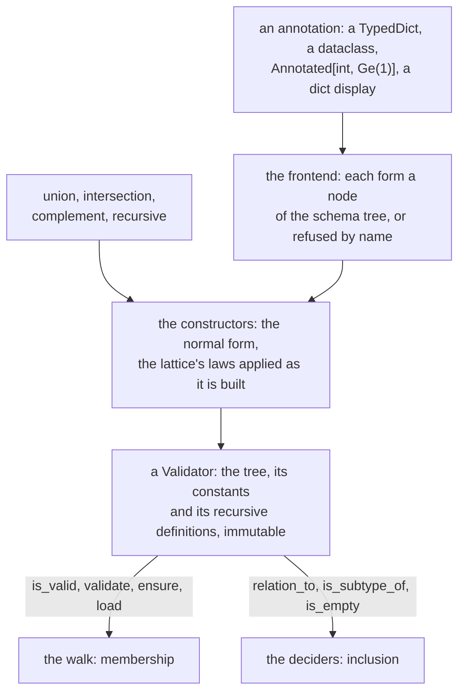
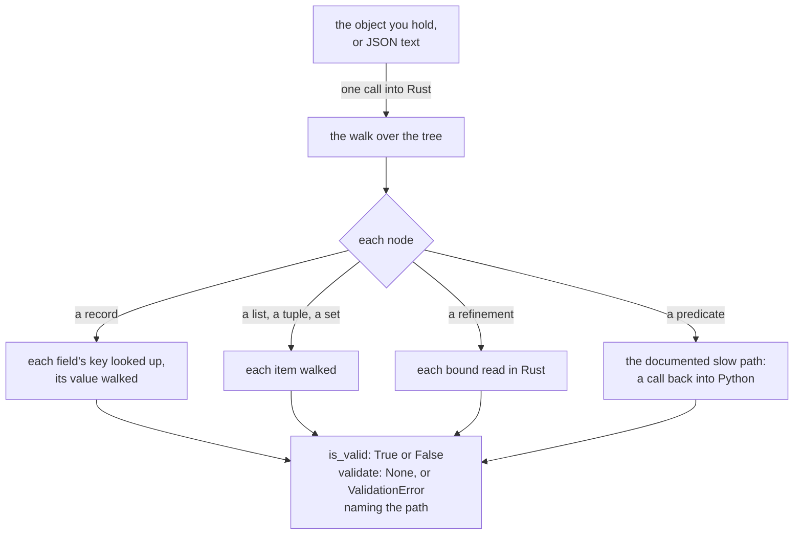
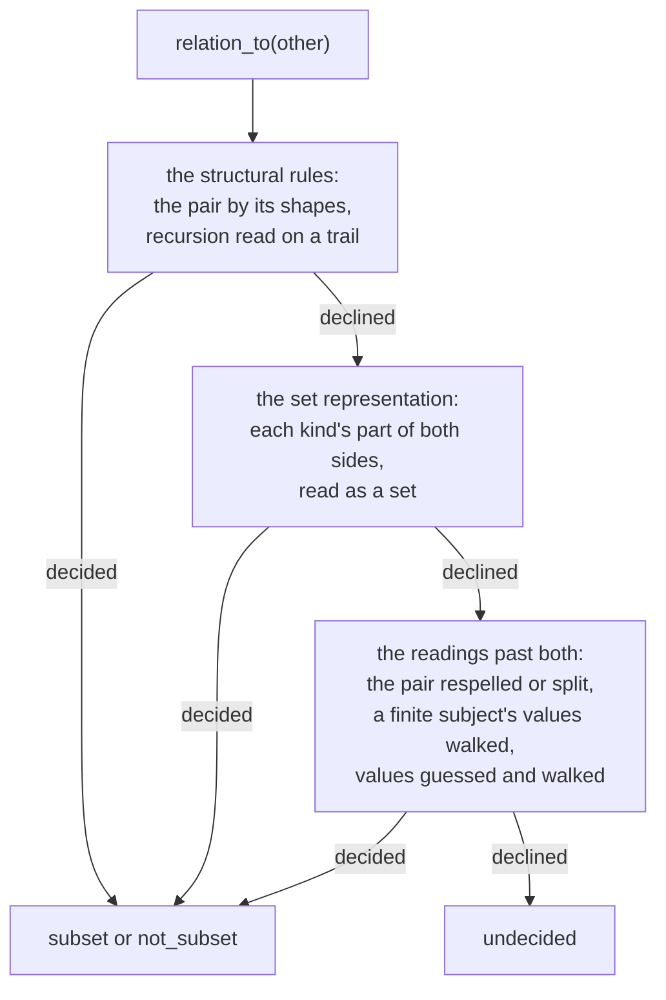

# How it works

A type annotation becomes a set of Python values, compiled once into a Rust validator tree,
and the set answers two questions: whether a value you hold belongs to it, and whether every
value of one set belongs to another. This page follows one schema from its annotation to both
answers. [The foundations](foundations.md) state the model, and
[the decidability boundary](decidability.md) what the second question decides.

## Two questions, one set

```python
from typing import Annotated, TypedDict

import annotated_types as at

from valgebra import Validator


class Order(TypedDict):
    sku: str
    qty: Annotated[int, at.Ge(1)]


class Line(TypedDict):
    sku: str
    qty: int


orders = Validator(Order)

# Membership: whether the dict you hold belongs to the set.
assert orders.is_valid({"sku": "a1", "qty": 2})
assert not orders.is_valid({"sku": "a1", "qty": 0})

# Inclusion: whether every value of one set belongs to the other.
assert orders.relation_to(Line) == "subset"
assert Validator(Line).relation_to(Order) == "not_subset"
```

The first question is about one value. The second is about every value at once, so no run of
a validator answers it: whether a new version of a contract admits every value the old one
did, or whether one check makes another redundant.

## From an annotation to a validator



- **The frontend.** `Validator(annotation)` reads each typing form into one node of a schema
  tree: a `TypedDict` or a dataclass into a record of its fields, `Annotated` into a refinement
  of its base, a `Literal` into its constants. A form it cannot read as a set is refused with
  an error naming it, never skipped. [The schema language](../guides/schema-language.md) lists
  every form with the set it denotes.
- **The normal form.** `union`, `intersection`, `complement` and `recursive` compose sets the
  annotations do not spell, and every node is built through the constructors, which apply the
  lattice's laws as they build: a set met with its own complement is `nothing`, joined with it
  `anything`. Two validators are equal where their normal forms are.
- **Once.** The tree is built when the `Validator` is, and every later call reads it.

```python
from valgebra import anything, complement, intersection, nothing, union

assert intersection(int, complement(int)) == nothing
assert union(int, complement(int)) == anything
```

## Membership: the walk



A call crosses into Rust once and walks the tree over the object you pass: it reads the
object, and neither copies nor converts it. `is_valid` answers `True` or `False`, `validate`
returns `None` or raises a `ValidationError` holding each failure's path and code, and `ensure`
returns the object itself once it is a member. JSON text takes the same walk over the values
the Rust parser reads from it (`is_valid_json`, `validate_json`, and `load`, which returns those
values), and both reach one walk, which reads a parsed JSON value as it reads the Python value
it stands for. A predicate is the one node that runs your code: membership calls it, and that
call is [the slow path](../guides/refinements.md#predicates-the-slow-path).

```python
from typing import Annotated, TypedDict

import annotated_types as at

from valgebra import ValidationError, Validator


class Order(TypedDict):
    sku: str
    qty: Annotated[int, at.Ge(1)]


orders = Validator(Order)
order = {"sku": "a1", "qty": 2}
assert orders.ensure(order) is order
assert orders.load('{"sku": "a1", "qty": 2}') == order

try:
    orders.validate({"sku": "a1", "qty": 0})
except ValidationError as failure:
    [error] = failure.errors
else:
    raise AssertionError("a quantity of 0 is refused")
assert (error["path"], error["code"]) == (("qty",), "greater_than_equal")
```

[The error model](../guides/error-model.md) states every code and the path format.

## Inclusion: three answers



The structural rules relate the two schemas by their shapes, and read a recursive schema by
the pairs already met on the way. Where they decline, the set representation reads each kind's
part of both sides as a set, under bounds on what it builds. Where both decline, the pair is
asked again respelled, split on a set the other side negates, or, for a subject of finitely
many constants or values guessed from its spelling, walked value by value: a guessed value the
subject admits and the other refuses refutes the pair, and no guess ever proves it.

| `relation_to` answers | meaning |
|---|---|
| `subset` | valgebra proves every value of the first set lies in the second |
| `not_subset` | valgebra proves a value of the first set lies outside the second |
| `undecided` | neither: a predicate it would have to look inside, a shape past what it decides, or a bound it stopped at |

`undecided` is never read as either of the others, so a caller relying on `subset` never relies
on a guess. `is_subtype_of` is `True` on `subset` alone, and `is_empty` asks the same question
against `nothing`. [Soundness](soundness.md) argues why `subset` and `not_subset` are proofs,
and [the decidability boundary](decidability.md) lists what each shape decides.

```python
from typing import Annotated

import annotated_types as at

from valgebra import Validator

positive = Annotated[int, at.Predicate(lambda n: n > 0)]

# A refinement lies inside its base whatever it asks of a value.
assert Validator(positive).relation_to(int) == "subset"
# Whether every integer is positive is a question about the predicate's code.
assert Validator(int).relation_to(positive) == "undecided"
```

## Where it sits

| a tool | answers |
|---|---|
| pydantic, msgspec | a value built from untyped input, converted to the target type |
| a static checker: ty, mypy, pyright | what code may hold, read before it runs |
| valgebra | whether the object held is in a set, and whether one set is in another |
| [valgebra-jsonschema](https://ppigazzini.github.io/valgebra-jsonschema/) | a JSON Schema document read into a valgebra set |
| [valgebra-planning](https://ppigazzini.github.io/valgebra-planning/) | a program of tool calls proven well-typed over those sets |

[The home page](../index.md#what-valgebra-is-for) says where a parser serves better, and
[static checking](../guides/static-checking.md) what a checker reads from a schema.

## What it does not cover

- **No conversion.** `ensure` returns the object it was given, and `load` returns the values
  the JSON text holds; nothing builds an instance of a class from a dict, or a number from a
  string.
- **A predicate is opaque.** Membership through it runs it; a relation that has to look inside
  it is `undecided`.
- **An inclusion can be undecided.** A shape past what the deciders read, or past a bound they
  stop at, answers `undecided`, and [the decidability boundary](decidability.md) lists each.
- **A value is checked when it is asked about.** A mutation after a check is not seen until the
  next one; [what it cannot do](boundaries.md) states each limit of a runtime check.
